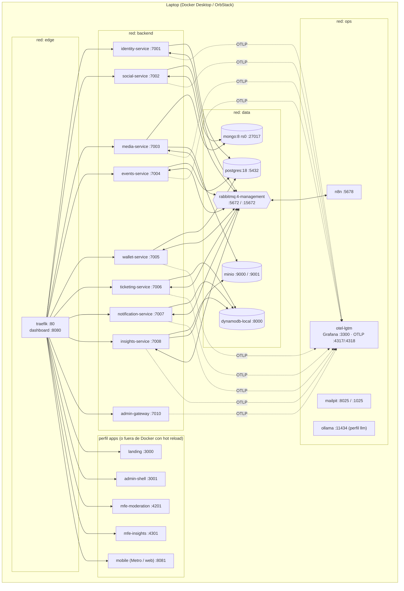
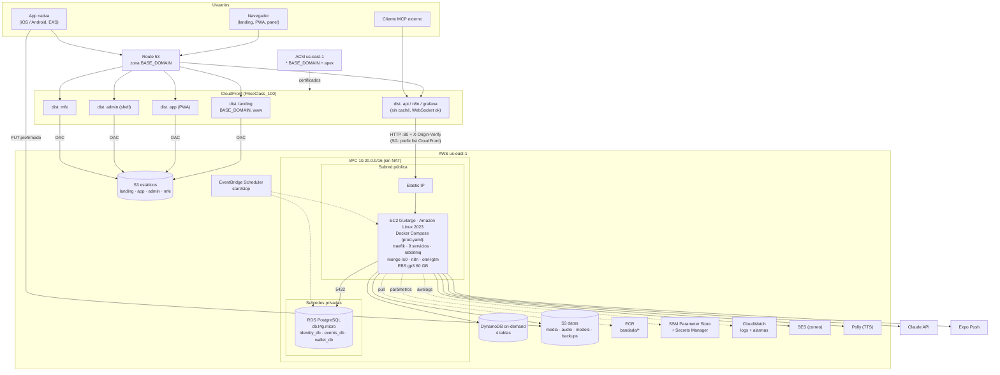
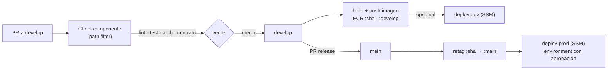
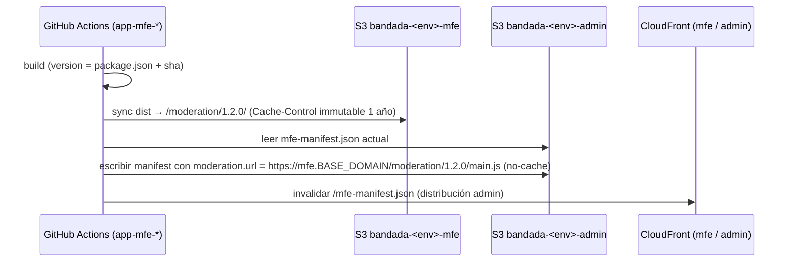

# Infraestructura — Bandada U

> **Estado (2026-10-15).** El entorno **local** (§2: Docker Compose + Traefik) está **implementado y verificado** en
> `bandadau-infra` (`make up && make seed && make smoke`). Diferencias reales respecto a este diseño:
> - Un solo `docker-compose.yaml` en la raíz de `bandadau-infra` (no `compose/`), con perfiles `infra`, `services`,
>   `observability` y `llm`.
> - MongoDB fijado en `mongo:8.0.19` (las 8.0.2x+ no arrancan en el kernel de Docker Desktop, SERVER-121912) y MinIO como
>   `pgsty/minio` (la imagen oficial ya no se publica). n8n usa SQLite en un volumen.
> - Wallet y notification corren con la misma imagen en roles web / worker / relay
>   (`wallet:consume-commands`, `wallet:relay-outbox`, `notifications:consume`, `notifications:relay-outbox`).
> - Los frontends **no** van en Docker en local: se ejecutan con sus comandos (`pnpm dev`) y Traefik los reenvía desde
>   `host.docker.internal`.
> - Comandos reales: `make setup | up | seed | smoke | mock | down | reset | urls`.
> - **AWS (§3 en adelante, CloudFormation, CI/CD de despliegue) sigue siendo diseño**: `bandadau-infra/aws/` aún no existe.
> Variables por componente: `entornos-y-variables.md`. Decisiones de implementación: ADR-0018.

Cómo se levanta Bandada U en **local** (Docker Compose + Traefik), cómo se despliega la
**demo en AWS** (un host EC2 + servicios gestionados baratos) y cómo funciona el **CI/CD**
por repositorio (ADR-0017). Los nombres de servicios, puertos, imágenes, colas y tablas salen de
`bandadau-docs/docs/03-arquitectura/catalogo-servicios.md` (normativo); este documento **no** los redefine.
Variables de entorno, URLs por entorno y secretos: `entornos-y-variables.md`.

> Inspiración: el repositorio de infraestructura de Homy del mismo equipo (EC2 + RDS + S3 +
> CloudFront, CloudFormation, Secrets Manager, CI en GitHub Actions, *deploy* por SSM, sin ALB
> ni NAT Gateway). Bandada U reutiliza sus ideas en su propio repositorio `bandadau-infra` (como `homy-infra`).

---

## 1. Principios

1. **Un comando**: `make up` levanta todo en < 10 min en una máquina de 16 GB (RNF-16).
2. **Paridad local ↔ AWS**: el mismo `docker-compose` (con *overrides*) corre en la laptop y
   en el EC2; lo que en local es emulado (DynamoDB Local, MinIO, Mailpit, Postgres en
   contenedor) en AWS se reemplaza por el servicio gestionado **solo cambiando variables**.
3. **Barato**: un host EC2, sin ALB, sin NAT Gateway, sin EKS. CloudFront es el único CDN/edge.
   Objetivo RNF-18 (≤ USD 60/mes) con apagado programado (ver §6.4).
4. **Mínimo privilegio** (RNF-07): un usuario de base de datos por servicio, un usuario de
   RabbitMQ por servicio, políticas IAM por prefijo de tabla/bucket, `/internal/**` bloqueado
   en el gateway.
5. **Dominio parametrizado**: nada tiene el dominio escrito a mano; todo deriva de
   `BASE_DOMAIN` (`bandada.localhost` en local, `bandadau.com` de referencia en prod).
6. **Sin secretos en git**: `.env.example` con valores de desarrollo; en AWS los secretos viven
   en SSM Parameter Store / Secrets Manager (ver `entornos-y-variables.md` §5).

---

## 2. Entorno local (Docker Compose)

### 2.1 Vista general



### 2.2 Perfiles de Compose

Un solo proyecto Compose (`name: bandada`) compuesto por varios archivos en `bandadau-infra/compose/`
(incluidos con `include:` desde `bandadau-infra/compose/compose.yaml`). Cada contenedor pertenece a un
**perfil**; `COMPOSE_PROFILES` en `bandadau-infra/.env` decide qué se levanta.

| Perfil | Contenedores | Uso típico |
|---|---|---|
| `infra` | `traefik`, `postgres`, `mongo`, `mongo-init`, `dynamodb-local`, `dynamodb-init`, `rabbitmq`, `minio`, `minio-init`, `n8n`, `lgtm`, `mailpit` | Siempre. Base para desarrollar cualquier servicio desde el IDE |
| `services` | los 9 servicios del catálogo §1 | Probar integraciones / SAGA de punta a punta |
| `apps` | `landing`, `admin-shell`, `mfe-moderation`, `mfe-insights`, `mobile-web` (servidores de desarrollo o `nginx` sirviendo el *build*) | Demo local completa |
| `llm` | `ollama` (+ `ollama-pull` que descarga el modelo una vez) | Agentes sin API de pago |
| `tools` | `k6`, `seed` (one-shot) | Pruebas de carga y datos de demo |

| Comando | Perfiles |
|---|---|
| `make infra-up` | `infra` |
| `make up` | `infra,services` |
| `make up-all` | `infra,services,apps` |
| `make up PROFILES=infra,services,llm` | personalizado |
| `make svc S=wallet-service` | levanta `infra` + solo ese servicio (los demás se corren desde el IDE) |

> Trabajo diario recomendado: `make infra-up` y correr **en el host** el servicio/app que se está
> editando (hot reload). Traefik también enruta hacia `host.docker.internal:<puerto>` cuando la
> variable `<SERVICIO>_UPSTREAM=host` está activa (ver `bandadau-infra/traefik/dynamic/`), así
> `api.bandada.localhost` funciona igual tanto si el servicio corre en Docker como en el IDE.

### 2.3 Redes

| Red | Miembros | Motivo |
|---|---|---|
| `edge` | `traefik` + todo lo que recibe tráfico HTTP (servicios, apps, n8n, Grafana, MinIO consola, RabbitMQ UI, Mailpit) | Único punto de entrada |
| `backend` | los 9 servicios + `n8n` | Llamadas `/internal/v1/**` servicio a servicio (no pasan por Traefik) |
| `data` | bases, broker, MinIO + los servicios que los usan + `n8n` (RabbitMQ) | Aislar datos del edge |
| `ops` | `lgtm`, `mailpit`, `ollama` + servicios | Telemetría, correo, LLM local |

Los puertos de las bases (`5432`, `27017`, `8000`, `5672`, `9000`) se publican en `127.0.0.1`
solo para depurar desde el host (DBeaver, Compass, `aws dynamodb --endpoint-url`).

### 2.4 Volúmenes

| Volumen | Contenedor | Montaje | Nota |
|---|---|---|---|
| `pg-data` | postgres | `/var/lib/postgresql` | La imagen `postgres:18` cambió el `PGDATA` a un subdirectorio por versión; se monta el directorio padre (verificar en la doc de la imagen al implementar) |
| `mongo-data`, `mongo-config` | mongo | `/data/db`, `/data/configdb` | |
| `mongo-keyfile` | mongo | `/etc/mongo-keyfile` | *keyFile* requerido por replica set + auth (lo genera `mongo-init` la primera vez) |
| `dynamodb-data` | dynamodb-local | `/home/dynamodblocal/data` | Arrancar con `-sharedDb -dbPath ./data` para persistir |
| `rabbitmq-data` | rabbitmq | `/var/lib/rabbitmq` | |
| `minio-data` | minio | `/data` | |
| `n8n-data` | n8n | `/home/node/.n8n` | SQLite propio de n8n (no usa Postgres: la instancia Postgres tiene exactamente 3 bases) |
| `lgtm-data` | lgtm | `/data` | Retención corta en local |
| `ollama-models` | ollama | `/root/.ollama` | Modelos descargados (varios GB) |
| `models-cache` | media-service, insights-service | `/var/cache/bandada/models` | Caché local de los ONNX descargados de MinIO/S3 |

`make reset` borra todos los volúmenes del proyecto (pide confirmación).

### 2.5 Contenedores de infraestructura (perfil `infra`)

| Servicio Compose | Imagen (fijar tag exacto al implementar) | Puertos host | Healthcheck | Depende de |
|---|---|---|---|---|
| `traefik` | `traefik:v3.x` | `80`, `8080` (dashboard, solo local) | `traefik healthcheck --ping` | — |
| `postgres` | `postgres:18` | `127.0.0.1:5432` | `pg_isready -U postgres` | — |
| `mongo` | `mongo:8` | `127.0.0.1:27017` | `mongosh --quiet --eval "db.adminCommand('ping').ok"` + estado del rs | — |
| `mongo-init` | `mongo:8` (one-shot) | — | termina con código 0 | `mongo` healthy |
| `dynamodb-local` | `amazon/dynamodb-local` | `127.0.0.1:8000` | (la imagen no trae curl) → lo cubre `dynamodb-init` | — |
| `dynamodb-init` | `amazon/aws-cli` (one-shot) | — | reintenta `list-tables` hasta responder, crea tablas | `dynamodb-local` started |
| `rabbitmq` | `rabbitmq:4-management` | `127.0.0.1:5672`, `15672` | `rabbitmq-diagnostics -q ping` | — |
| `minio` | `minio/minio` | `9000`, `9001` | `mc ready local` | — |
| `minio-init` | `minio/mc` (one-shot) | — | código 0 | `minio` healthy |
| `n8n` | `n8nio/n8n` | `5678` | `wget -qO- http://localhost:5678/healthz` | `rabbitmq` healthy |
| `lgtm` | `grafana/otel-lgtm` | `3300→3000`, `4317`, `4318` | `curl -f http://localhost:3000/api/health` | — |
| `mailpit` | `axllent/mailpit` | `8025`, `1025` | `wget -qO- http://localhost:8025/livez` | — |
| `ollama` (perfil `llm`) | `ollama/ollama` | `11434` | `ollama list` | — |

### 2.6 Servicios (perfil `services`)

| Servicio Compose | Imagen | Puerto | Healthcheck | `depends_on` (condición) |
|---|---|---|---|---|
| `identity-service` | `bandada/identity-service` | 7001 | `GET /health/ready` | postgres healthy, rabbitmq healthy |
| `social-service` | `bandada/social-service` | 7002 | `GET /health/ready` | mongo-init completed, rabbitmq, dynamodb-init completed |
| `media-service` | `bandada/media-service` | 7003 | `GET /health/ready` | mongo-init, minio-init completed, rabbitmq, dynamodb-init |
| `events-service` | `bandada/events-service` | 7004 | `GET /health/ready` | postgres, rabbitmq, dynamodb-init |
| `wallet-service` | `bandada/wallet-service` | 7005 | `GET /health/ready` | postgres, rabbitmq, dynamodb-init |
| `ticketing-service` | `bandada/ticketing-service` | 7006 | `GET /health/ready` | dynamodb-init, rabbitmq |
| `notification-service` | `bandada/notification-service` | 7007 | `GET /health/ready` | dynamodb-init, rabbitmq, mailpit |
| `insights-service` | `bandada/insights-service` | 7008 | `GET /health/ready` | dynamodb-init, minio-init, rabbitmq |
| `admin-gateway` | `bandada/admin-gateway` | 7010 | `GET /health/ready` | identity-service healthy |

- Las imágenes se construyen con el `Dockerfile` **del propio servicio**
  (`bandadau-backend/services/<x>/Dockerfile`, multi-stage, usuario no root); Compose solo las referencia con
  `build.context: ../../bandadau-backend/services/<x>` (relativo a `bandadau-infra/compose/`; repo hermano). Igual que en Homy, el Dockerfile vive con el código.
- Todas las imágenes incluyen `wget` o `curl` para el healthcheck
  (`wget -qO- http://localhost:${PORT}/health/ready`), `start_period` 60 s para Spring y 20 s
  para el resto, `interval` 10 s, `retries` 6.
- **Procesos auxiliares (misma imagen, otro `command`)**: en los servicios Laravel el consumidor
  y el relay del outbox son comandos artisan de larga vida (`eventos-y-mensajeria.md` §6), por lo
  que se declaran como contenedores extra sin puerto HTTP: `wallet-service-consumer`
  (`php artisan bandada:consume wallet-service.commands`), `wallet-service-outbox-relay`,
  `notification-service-consumer` (y su relay si publica). Su healthcheck es un *heartbeat*
  (archivo tocado cada 30 s). En Spring y NestJS el consumidor y el relay corren dentro del
  mismo proceso del servicio.
- Los servicios **no** dependen entre sí en el arranque (salvo `admin-gateway` → identity por
  JWKS): la degradación elegante (RNF-03) se prueba apagando contenedores.
- Variables comunes: anclas YAML `x-service-env` (RabbitMQ, OTLP, JWKS, DynamoDB) y un
  `env_file: ../../bandadau-backend/services/<x>/.env` opcional para sobreescribir.

### 2.7 Traefik (gateway)

- Configuración estática en `bandadau-infra/traefik/traefik.yml`: *entrypoint* `web` (:80), en prod
  además `websecure` (:443 solo si no hay CloudFront, ver §6), proveedor Docker
  (`exposedByDefault: false`) + proveedor *file* (`bandadau-infra/traefik/dynamic/*.yml`), `ping`,
  métricas OTLP, *access log* JSON.
- Enrutamiento por `Host` + `PathPrefix` exactamente como el catálogo §4, con `BASE_DOMAIN`:

| Router | Regla | Servicio |
|---|---|---|
| `identity` | ``Host(`api.${BASE_DOMAIN}`) && (PathPrefix(`/api/v1/auth`) \|\| PathPrefix(`/api/v1/users`) \|\| PathPrefix(`/api/v1/universities`) \|\| PathPrefix(`/.well-known`))`` | identity-service:7001 |
| `social` | `… PathPrefix(/api/v1/profiles\|posts\|feed\|groups\|follows\|reports)` | social-service:7002 |
| `media` | `/api/v1/media` | media-service:7003 |
| `events` | `/api/v1/events`, `/api/v1/registrations` | events-service:7004 |
| `wallet` | `/api/v1/wallet` | wallet-service:7005 |
| `ticketing` | `/api/v1/tickets` | ticketing-service:7006 |
| `notification` | `/api/v1/notifications`, `/api/v1/devices` | notification-service:7007 |
| `insights` | `/api/v1/insights`, `/mcp` | insights-service:7008 |
| `graphql` | `/graphql` (HTTP + WebSocket) | admin-gateway:7010 |
| `internal-block` | `PathPrefix(/internal)` en `api.*` (prioridad máxima) | `noop@internal` + middleware que responde **403** |
| `landing` | `Host(${BASE_DOMAIN}) \|\| Host(www.${BASE_DOMAIN})` | landing:3000 |
| `app` | `Host(app.${BASE_DOMAIN})` | mobile-web:8081 |
| `admin` | `Host(admin.${BASE_DOMAIN})` | admin-shell:3001 |
| `mfe` | `Host(mfe.${BASE_DOMAIN}) && PathPrefix(/moderation)` / `/insights` | mfe-moderation:4201 / mfe-insights:4301 (*stripPrefix* solo en dev server si hace falta) |
| `s3` | `Host(s3.${BASE_DOMAIN})` | minio:9000 (URLs prefirmadas accesibles desde el navegador/emulador) |
| `n8n`, `grafana`, `rabbitmq`, `mailpit`, `minio-console` | `Host(n8n.${BASE_DOMAIN})`, … | UIs de operación |

- **Middlewares** (`bandadau-infra/traefik/dynamic/middlewares.yml`): `cors` (orígenes = app, admin, mfe,
  landing del mismo `BASE_DOMAIN`; cabeceras `Authorization`, `Idempotency-Key`,
  `X-Correlation-Id`, `traceparent`, `Accept-Language`; expone `Idempotent-Replayed`,
  `Content-Language`), `ratelimit-auth` (10/min/IP en `/api/v1/auth/*`, RNF-06),
  `ratelimit-default`, `secure-headers`, `correlation-id` (genera `X-Correlation-Id` si falta),
  `ops-auth` (basic auth para n8n/Grafana en prod), `compress`.
- `*.localhost` resuelve a `127.0.0.1` en navegadores modernos y macOS; en Linux/Android se
  documenta la entrada de `/etc/hosts` o el uso de la IP LAN (`EXPO_PUBLIC_API_URL`) para el
  teléfono físico.

### 2.8 Inicialización de datos

#### PostgreSQL — 3 bases, 3 usuarios

`bandadau-infra/postgres/init/01-create-databases.sh` (montado en `/docker-entrypoint-initdb.d/`, solo
corre con el volumen vacío). Las contraseñas llegan por variables (`IDENTITY_DB_PASSWORD`, …).

```sql
-- por cada par (identity|events|wallet):
CREATE ROLE identity LOGIN PASSWORD :'identity_pw';
CREATE DATABASE identity_db OWNER identity;
REVOKE CONNECT ON DATABASE identity_db FROM PUBLIC;
GRANT CONNECT ON DATABASE identity_db TO identity;
-- dentro de identity_db:
REVOKE ALL ON SCHEMA public FROM PUBLIC;
ALTER SCHEMA public OWNER TO identity;
```

- Los esquemas los crea **cada servicio** con sus migraciones (Flyway en Spring, migraciones de
  Laravel en wallet); el init solo crea bases y usuarios.
- En RDS no existe `docker-entrypoint-initdb.d`: el mismo script se ejecuta una vez con el
  contenedor one-shot `db-bootstrap` (perfil `bootstrap`) usando el usuario maestro de RDS.

#### MongoDB — replica set `rs0`

- `mongo` arranca con `--replSet rs0 --bind_ip_all --keyFile /etc/mongo-keyfile/key` y usuario
  raíz (`MONGO_INITDB_ROOT_*`).
- `mongo-init` (one-shot, `bandadau-infra/mongo/init/init-replica.js` + `create-users.js`):
  1. `rs.initiate({ _id: "rs0", members: [{ _id: 0, host: "mongo:27017" }] })` si
     `rs.status()` falla; espera a `PRIMARY`.
  2. Crea los usuarios `social` (`readWrite` sobre la base `social`) y `media` (`readWrite` sobre `media`).
  3. No crea índices: cada servicio los asegura al arrancar (`createIndexes` idempotente).
- Desde el host, conectarse con `mongodb://…@localhost:27017/?directConnection=true`
  (el miembro del rs se anuncia como `mongo:27017`).

#### DynamoDB Local — tablas

`bandadau-infra/dynamodb/tables/*.json` (formato de entrada de `aws dynamodb create-table`) + script
`bandadau-infra/dynamodb/create-tables.sh` que ejecuta `dynamodb-init`:

| Archivo | Tabla | Claves | GSIs | TTL |
|---|---|---|---|---|
| `idempotency.json` | `bandada-idempotency` | `pk` (S) | — | `expiresAt` |
| `ticketing.json` | `bandada-ticketing` | `pk` (S), `sk` (S) | `GSI1` (`gsi1pk`,`gsi1sk`), `GSI2` (`gsi2pk`,`gsi2sk`) | — |
| `notifications.json` | `bandada-notifications` | `pk`, `sk` | — | `expiresAt` |
| `insights.json` | `bandada-insights` | `pk`, `sk` | `GSI1` (`gsi1pk`,`gsi1sk`) — ver propuesta en `06-modelo-estatico/insights.md` | `expiresAt` |

- Modo de facturación declarado `PAY_PER_REQUEST` (igual al de AWS) para que los mismos JSON
  sirvan para CloudFormation.
- El script es idempotente (`describe-table` antes de `create-table`) y luego aplica
  `update-time-to-live`. **DynamoDB Local no garantiza el borrado por TTL**: el código siempre
  filtra por `expiresAt` además de confiar en el TTL.
- Credenciales ficticias en local (`AWS_ACCESS_KEY_ID=local`, región `us-east-1`).

#### MinIO — buckets

`minio-init` (`bandadau-infra/minio/init.sh`) con `mc`:

| Bucket | Uso | Política |
|---|---|---|
| `bandada-media` | Fotos/videos de usuarios (`uploads/<ownerId>/<mediaId>/original`, `…/thumb.jpg`, `…/frames/`) | privado; acceso solo por URL prefirmada (RNF-08) |
| `bandada-reports` | Audios de reportes generativos (`reports/<reportId>.mp3`) | privado |
| `bandada-models` | Modelos ONNX `models/<nombre>/<versión>/model.onnx` | privado; lectura por media/insights |
| `bandada-public` | Modelos on-device descargables por la app (`mobile/…`) y portadas públicas de eventos | lectura anónima (solo local; en AWS va detrás de CloudFront) |

Además crea usuarios MinIO por servicio (`media-svc`, `insights-svc`) con políticas por bucket
(simula IAM) y configura CORS para `PUT` prefirmado desde `app.${BASE_DOMAIN}`.
`make models-sync` sube a `bandada-models` los ONNX exportados desde `bandadau-ml/`.

#### RabbitMQ — `definitions.json`

`bandadau-infra/rabbitmq/definitions.json` se carga al arrancar (`load_definitions` en
`bandadau-infra/rabbitmq/rabbitmq.conf`). Lo genera `bandadau-infra/rabbitmq/render-definitions.sh` a partir de
`definitions.template.json` para insertar los *hashes* de contraseña desde `bandadau-infra/.env`.

- **vhost**: `/` (por defecto; las URLs de los servicios no indican vhost).
- **Exchanges** (durables): `bandada.events` (topic), `bandada.commands` (topic), `bandada.dlx` (topic).
- **Colas** (quorum, durables): exactamente las del catálogo §5 —
  `events-service.saga-replies`, `wallet-service.commands`, `ticketing-service.commands`,
  `social-service.events`, `media-service.events`, `notification-service.events`,
  `insights-service.analytics`, `n8n.automation` — cada una con
  `x-dead-letter-exchange: bandada.dlx` y `x-dead-letter-routing-key: <nombre-de-la-cola>`.
- **DLQ**: una cola `<nombre>.dlq` por cola, enlazada a `bandada.dlx` con su nombre como
  routing key (así la DLQ sabe de qué cola vino cada mensaje y el agente de monitoreo puede
  contarlas por servicio).
- **Bindings**: los del catálogo §5 (comandos sobre `bandada.commands`, el resto sobre
  `bandada.events`). Política de reintentos en el consumidor (3 intentos con *backoff*, luego
  `nack` sin requeue → DLQ); detalle en `bandadau-docs/docs/03-arquitectura/eventos-y-mensajeria.md`.
- **Usuarios**: en local, el usuario compartido `bandada` (el de los `.env.example` de los
  servicios) + `n8n` + `monitor`. En AWS (RNF-07): uno por servicio (`identity`, `social`, …, `n8n`) con permisos
  `configure: ^$`, `write` sobre los exchanges que publica y `read` sobre su cola; usuario
  `admin` solo para la UI; usuario `monitor` (tag `monitoring`, solo lectura) para la herramienta
  MCP `get_service_health`.

#### n8n

- Imagen oficial, base SQLite en `n8n-data`, `N8N_ENCRYPTION_KEY` fijo (si cambia, se pierden
  las credenciales guardadas), zona horaria `America/La_Paz`.
- Workflows **versionados en git** en `bandadau-infra/n8n/workflows/*.json`; `make n8n-import`
  ejecuta `n8n import:workflow --separate --input=/workflows` dentro del contenedor y
  `make n8n-export` hace lo inverso (antes de commitear).
- Credenciales por variables de entorno (RabbitMQ `n8n`, SMTP Mailpit, token de servicio para
  REST interno, bot de Telegram opcional). Detalle de workflows en
  `bandadau-docs/docs/03-arquitectura/automatizacion-n8n.md` (D10).
- `n8n` está en la red `backend` para llamar `/internal/v1/**` con token de servicio y en `data`
  para consumir `n8n.automation`.

### 2.9 Observabilidad local

`grafana/otel-lgtm` (Grafana + Loki + Tempo + Prometheus/Mimir + colector OTel) en un solo
contenedor. Todos los servicios exportan OTLP a `http://lgtm:4318` (HTTP) o `lgtm:4317` (gRPC).
Dashboards versionados en `bandadau-infra/observability/dashboards/` (SAGA, colas/DLQ, latencias por
servicio) y aprovisionados por montaje. Ver `bandadau-docs/docs/03-arquitectura/observabilidad.md`.

### 2.10 Datos de demo y pruebas de carga

- `make seed`: contenedor one-shot que llama a las **APIs** (nunca escribe en bases ajenas):
  universidades, usuarios por rol, grupos, posts, eventos (gratis y pagados), recargas.
  Credenciales de los usuarios de demo en `bandadau-infra/seed/README.md` (solo dev).
- `make load`: `k6` con los escenarios de `bandadau-infra/load/` (lecturas de feed, creación de posts,
  inscripción concurrente al mismo evento para verificar cupos + idempotencia). Umbrales de
  RNF-01/02 como `thresholds` de k6.

---

## 3. Estructura de la carpeta `bandadau-infra/`

```
bandadau-infra/
├── AGENTS.md  CLAUDE.md  README.md
├── .env.example                  # BASE_DOMAIN, COMPOSE_PROFILES, contraseñas dev, flags de caos
├── Makefile                      # punto de entrada del stack: make up, infra-up, seed… (se ejecuta desde bandadau-infra/)
├── compose/
│   ├── compose.yaml              # include de los demás + redes + volúmenes
│   ├── infra.yaml                # perfil infra
│   ├── services.yaml             # perfil services (build desde bandadau-backend/services/<x>/Dockerfile)
│   ├── apps.yaml                 # perfil apps
│   ├── tools.yaml                # perfiles tools / bootstrap / llm
│   ├── override.host-upstreams.yaml  # enrutar a servicios corriendo en el IDE
│   └── prod.yaml                 # override para el EC2 (imágenes de ECR, sin bases emuladas)
├── traefik/
│   ├── traefik.yml               # estático
│   └── dynamic/                  # routers file-provider, middlewares, host upstreams
├── postgres/init/01-create-databases.sh
├── mongo/init/{init-replica.js,create-users.js,keyfile.sh}
├── dynamodb/{create-tables.sh,tables/*.json}
├── rabbitmq/{rabbitmq.conf,definitions.template.json,render-definitions.sh}
├── minio/init.sh
├── n8n/                          # workflows JSON (wf-00…wf-06), plantillas, scripts y credenciales de ejemplo
├── observability/{dashboards/,alerts/,otel-collector.yaml}
├── seed/                         # scripts del seed (TS, llaman APIs)
├── load/                         # k6: scripts/*.js, thresholds.js, README
├── aws/
│   ├── cloudformation/
│   │   ├── network.yaml          # VPC, subredes, SG (sin NAT)
│   │   ├── data.yaml             # RDS, DynamoDB (4 tablas), buckets S3, backups
│   │   ├── compute.yaml          # EC2 + EIP + IAM role + user-data + CloudWatch
│   │   ├── edge.yaml             # ACM, CloudFront (api, landing, app, admin, mfe), Route53
│   │   ├── ci.yaml               # ECR repos, rol OIDC de GitHub Actions
│   │   └── scheduler.yaml        # EventBridge Scheduler start/stop del EC2 y RDS
│   ├── params/{dev,prod}.env.example
│   └── scripts/{deploy-stack.sh,host-deploy.sh,render-env.sh,deploy-static.sh,backup-mongo.sh}
└── ci/
    ├── actions/                  # composite actions reutilizables (uses: <org>/bandadau-infra/ci/actions/<acción>@main)
    │   ├── docker-build-push/    # build + push a ECR con caché GHA y Trivy
    │   ├── ssm-deploy/           # aws ssm send-command → host-deploy.sh <svc> <tag>
    │   └── static-deploy/        # s3 sync + cache-control + invalidación CloudFront
    └── templates/                # plantillas de workflow por tipo de componente (se copian al .github/workflows/ de cada repo)
```

Los workflows reales viven en el `.github/workflows/` **de cada repositorio** (GitHub solo los lee de ahí);
`bandadau-infra/ci/` guarda las piezas reutilizables y las plantillas.

---

## 4. AWS — demo

### 4.1 Diagrama de despliegue



### 4.2 Decisiones

| Tema | Decisión | Motivo |
|---|---|---|
| Cómputo | **1 EC2 `t3.xlarge`** (4 vCPU, 16 GB) con Docker Compose (`compose.yaml` + `prod.yaml`) | 9 servicios (2 JVM, 2 PHP-FPM, 5 Node) + RabbitMQ + Mongo + n8n + LGTM caben en 16 GB; igual que Homy, sin ECS/EKS |
| Ingreso | CloudFront → EIP del EC2 por HTTP :80, Traefik enruta por `Host` | TLS gratis con ACM en CloudFront, sin ALB (~USD 18/mes ahorrados). El SG del EC2 solo admite la *managed prefix list* `com.amazonaws.global.cloudfront.origin-facing` en :80 y Traefik exige la cabecera secreta `X-Origin-Verify` |
| API en CloudFront | *Cache policy* `CachingDisabled` + *origin request policy* `AllViewer` (reenvía `Host`, cabeceras, *query* y cookies); origen = `origin.${BASE_DOMAIN}` → EIP | Traefik necesita el `Host` (`api.`, `n8n.`, `grafana.`); WebSockets (`graphql-ws`) y *streaming* (MCP Streamable HTTP) funcionan en CloudFront |
| Postgres | **RDS PostgreSQL** `db.t4g.micro`, 20 GB gp3, Single-AZ, en subred privada | Gestionado y en capa gratuita el primer año si la cuenta califica; 3 bases + 3 usuarios creados por `db-bootstrap`. Versión 18 si RDS la ofrece; si no, la mayor disponible (verificar) |
| MongoDB | Contenedor `mongo:8` rs0 en el EC2 con volumen EBS + `mongodump` diario a S3 | Costo cero. **Alternativa**: MongoDB Atlas **M0** (gratis, 512 MB, replica set de 3 nodos → transacciones OK; sin backups ni métricas avanzadas, límite de conexiones) — libera ~1 GB de RAM del EC2 |
| DynamoDB | 4 tablas `PAY_PER_REQUEST` (mismos JSON que en local) | Céntimos al mes con tráfico de demo; PITR solo en `bandada-ticketing` |
| Object storage | S3: `bandada-<env>-media`, `-reports`, `-models`, `-backups` (privados, cifrado SSE-S3, *Block Public Access*) | URLs prefirmadas 15 min (RNF-08); CORS para `PUT` desde `app.` |
| Estáticos | S3 por sitio + CloudFront con **OAC**: `landing`, `app`, `admin`, `mfe` | Patrón Homy: HTML `no-cache`, assets con *hash* `max-age=31536000, immutable` |
| DNS/TLS | Route 53 (zona `BASE_DOMAIN`) + ACM en **us-east-1** (`BASE_DOMAIN`, `*.BASE_DOMAIN`; en dev además `*.dev.BASE_DOMAIN`) | Requisito de CloudFront |
| Secretos | SSM Parameter Store `SecureString` (gratis) para casi todo; Secrets Manager solo para la contraseña maestra de RDS (gestionada por RDS) y las llaves JWT | Secrets Manager cuesta USD 0.40/secreto/mes |
| Logs/métricas | Driver `awslogs` → CloudWatch (`/bandada/<env>/<servicio>`, retención 14 días) + LGTM en el host para trazas | Alarmas: CPU > 80 %, `StatusCheckFailed` (auto-recover), espacio en disco, 5xx en CloudFront |
| Correo | SES (dominio verificado, DKIM). En demo puede seguir en *sandbox* con destinatarios verificados | Mailpit solo en local |
| TTS / LLM | Polly (voz neural es-US/es-MX y en-US según `locale`) / Claude API | Por uso; costo de demo mínimo |
| Registro de imágenes | **ECR** (`bandada/<componente>`, *lifecycle*: últimas 10 imágenes) | El EC2 hace *pull* con su rol IAM (sin PAT). Alternativa: GHCR |
| Acceso al host | **SSM Session Manager** (sin SSH ni puerto 22 abierto) | Igual que el *deploy* |
| IaC | **CloudFormation** en `bandadau-infra/aws/cloudformation/` (pilas separadas por ciclo de vida) | Mismo enfoque que Homy; `cfn-lint` en CI |

### 4.3 Seguridad de red

| Security group | Entrada | Salida |
|---|---|---|
| `sg-host` (EC2) | :80 desde prefix list de CloudFront | todo (Internet Gateway; sin NAT) |
| `sg-db` (RDS) | :5432 solo desde `sg-host` | — |

- RabbitMQ, Mongo, LGTM, Postgres **no** se publican fuera del host/VPC. n8n y Grafana se
  publican vía CloudFront con `ops-auth` (basic auth en Traefik) + login propio; la alternativa
  más segura es no publicarlos y usar *port forwarding* de Session Manager.
- `/internal/**` → 403 en Traefik también en prod (las llamadas internas van por la red Docker).
- Rol IAM del EC2 con políticas por recurso: `dynamodb:*Item/Query/TransactWriteItems` sobre
  `bandada-*`, `s3:GetObject/PutObject` por bucket, `ssm:GetParametersByPath` sobre
  `/bandada/<env>/*`, `polly:SynthesizeSpeech`, `ses:SendEmail`, `ecr:*Pull*`, `logs:*`.
  Como todos los servicios comparten el host, el mínimo privilegio por servicio se refuerza
  con usuarios distintos de base de datos/broker y prefijos de clave; si se quisiera aislamiento
  IAM por servicio habría que pasar a ECS (fuera de alcance).

### 4.4 Costo estimado (us-east-1, precios de lista orientativos; verificar en la calculadora de AWS)

| Recurso | 24/7 | Con apagado programado (≈ 12 h/día L–V, ~260 h/mes) |
|---|---|---|
| EC2 `t3.xlarge` (USD 0.1664/h) | ~ 121 | ~ 43 |
| EBS gp3 60 GB + snapshots | ~ 6 | ~ 6 |
| IPv4 pública (EIP) | ~ 3.7 | ~ 3.7 |
| RDS `db.t4g.micro` + 20 GB | ~ 14 (0 en capa gratuita) | ~ 6 (detenido fuera de horario; RDS se reinicia solo tras 7 días) |
| DynamoDB on-demand (4 tablas) | < 1 | < 1 |
| S3 + CloudFront (capa gratuita 1 TB) | ~ 1–2 | ~ 1–2 |
| Route 53 (zona) | 0.5 | 0.5 |
| Secrets Manager (2–3 secretos) | ~ 1.2 | ~ 1.2 |
| CloudWatch logs/alarmas | ~ 3 | ~ 2 |
| ECR (≈ 5 GB) | ~ 0.5 | ~ 0.5 |
| SES / Polly / Claude API (demo) | ~ 2–5 | ~ 2–5 |
| **Total aproximado** | **~ USD 150** | **~ USD 65** (≈ 55 con RDS en capa gratuita) |

Alternativas para bajar costo (combinables):

| Alternativa | Ahorro aprox. | Costo / riesgo |
|---|---|---|
| **Apagado programado** (EventBridge Scheduler: EC2 + RDS fuera de horario de trabajo y demo) | −55 % del EC2 | Hay que encender a mano para demos fuera de horario (`make aws-start`) |
| Instancia **Spot** `t3.xlarge` (persistente, *stop* en interrupción) | −60–70 % | Interrupciones; no usar el día de la defensa (cambiar a on-demand) |
| `t3.large` (8 GB) + **MongoDB Atlas M0** + sin LGTM en el host (Grafana Cloud free o solo CloudWatch) + Ollama nunca en prod | −50 % del EC2 | Menos margen de RAM; M0 tiene 512 MB y sin backups |
| Postgres en contenedor en el EC2 en vez de RDS | −14 | Se pierde "gestionado", backups manuales |
| Un solo entorno AWS (sin `dev` permanente; `dev` = local) | −50 % total | Las pruebas en nube se hacen sobre `prod` antes de la demo |
| Savings Plan 1 año | −30–40 % | Compromiso anual (no tiene sentido para un semestre) |

**Recomendación**: un solo entorno AWS (`prod`, rama `main`) con apagado programado
(≈ USD 55–65/mes, cumple RNF-18 en su variante "≤ USD 60" con RDS en capa gratuita), y `dev`
efímero solo en las semanas de integración. Para la semana de la defensa, encendido 24/7
on-demand (≈ USD 35 esa semana).

### 4.5 Arranque del host (user-data) y `deploy`

1. *User-data* (CloudFormation `compute.yaml`): instala Docker + plugin Compose + AWS CLI + jq,
   crea `/opt/bandada/`, descarga `bandadau-infra/compose/*.yaml`, `traefik/`, `rabbitmq/` desde un
   paquete versionado en S3 (`bandada-<env>-backups/releases/infra-<sha>.tgz`), ejecuta
   `render-env.sh` y `docker compose --profile services up -d`.
2. `render-env.sh` lee `ssm get-parameters-by-path /bandada/<env>/` y escribe
   `/opt/bandada/env/<servicio>.env` (`chmod 600`). Igual que en Homy, solo se reescribe si cambió
   un parámetro (evita reinicios innecesarios).
3. `host-deploy.sh <componente> <tag>`: actualiza `IMAGE_TAG_<COMPONENTE>` en
   `/opt/bandada/images.env`, `docker compose pull <svc>`, `up -d --no-deps <svc>`, espera
   `/health/ready` (timeout 120 s); si falla, vuelve al tag anterior y sale con error
   (*rollback* automático).
4. Migraciones: Spring (Flyway) y Laravel (`php artisan migrate --force`) corren al arrancar el
   contenedor; las migraciones deben ser **compatibles hacia atrás** (expand/contract) porque el
   *rollback* no las revierte.

---

## 5. CI/CD (GitHub Actions)

### 5.1 Flujo general



### 5.2 Un workflow por componente con *path filters*

Cada repositorio tiene **sus propios** workflows en su `.github/workflows/` (ADR-0017). Dentro de
`bandadau-backend` y `bandadau-admin` se usan *path filters* por servicio o app. Los jobs que necesitan
contratos o paquetes compartidos hacen *checkout* de `bandadau-docs` y `bandadau-shared` como carpetas
hermanas (misma estructura que el workspace local).

| Repo · workflow | `paths` que lo disparan (relativos al repo) | Jobs |
|---|---|---|
| `bandadau-docs` · `contracts.yml` | `contracts/**` | Spectral (OpenAPI), AsyncAPI CLI validate, graphql-inspector (*breaking changes* contra `main`), ajv (MCP); regenera `@bandada/contracts-ts` en un checkout hermano de `bandadau-shared` y avisa si hay diff pendiente |
| `bandadau-backend` · `svc-identity.yml` / `svc-events.yml` | `services/<x>/**` | Gradle: Spotless, Checkstyle, JUnit + Testcontainers, **ArchUnit**, contrato contra `../bandadau-docs/contracts`, build imagen, Trivy, push |
| `bandadau-backend` · `svc-wallet.yml` / `svc-notification.yml` | `services/<x>/**` | Pint, PHPStan/Larastan, Pest, **Deptrac**, contrato, imagen |
| `bandadau-backend` · `svc-social.yml`, `svc-media.yml`, `svc-ticketing.yml`, `svc-insights.yml`, `svc-admin-gateway.yml` | `services/<x>/**` | pnpm (filtro `--filter <x>...`, `@bandada/*` desde el checkout hermano de `bandadau-shared`), ESLint, Jest + Testcontainers, **dependency-cruiser**, imagen |
| `bandadau-landing` · `app-landing.yml` | `**` | lint, `i18n:check`, test, `next build` (export), Lighthouse/axe, deploy estático |
| `bandadau-admin` · `app-admin-shell.yml` | `shell/**` | lint, `i18n:check`, test, `next build` (export), deploy estático |
| `bandadau-admin` · `app-mfe-moderation.yml` | `mfe-moderation/**` | `ng lint`, `ng test`, `i18n:check`, build Elements, deploy MFE |
| `bandadau-admin` · `app-mfe-insights.yml` | `mfe-insights/**` | lint, Vitest, `i18n:check`, `vite build --mode lib`, deploy MFE |
| `bandadau-frontend` · `app-mobile.yml` | `**` | lint, test, `i18n:check`, `expo export -p web` + Lighthouse CI (RNF-10), deploy PWA; EAS Build/Update (§5.4) |
| `bandadau-shared` · `packages.yml` | `packages/**` | build + test de librerías (incl. contraste de `ui-tokens` e `i18n:check`); los consumidores se revalidan en su propio CI |
| `bandadau-ml` · `ml.yml` | `**` | Ruff, pytest; validación ONNX (carga + inferencia de humo); **no** entrena en CI |
| `bandadau-infra` · `n8n.yml` | `n8n/**` | Valida JSON y que no haya credenciales embebidas |
| `bandadau-infra` · `infra.yml` | `**` (excepto `n8n/**`) | `docker compose config --quiet`, `cfn-lint`, `hadolint` en Dockerfiles (checkout hermano de los repos con código), render de `definitions.json` |
| `bandadau-infra` · `e2e-nightly.yml` | cron + manual | checkout de los 8 repos como hermanos, `make up`, `make seed`, pruebas de sistema (SAGA con caos, idempotencia), k6 corto |

- `concurrency: <workflow>-${{ github.ref }}` con `cancel-in-progress` (igual que Homy).
- Autenticación en AWS con **OIDC** (`aws-actions/configure-aws-credentials`, rol
  `bandada-gha-<env>` creado por `ci.yaml`, condicionado a `repo:<org>/<repo>:ref:refs/heads/main|develop`):
  sin llaves de larga duración en GitHub.
- **Imágenes**: `docker/build-push-action` con caché `type=gha`, tags `:<sha>`,
  `:<rama>`; etiqueta OCI `org.opencontainers.image.revision`. Trivy en modo reporte
  (`--exit-code 0` al inicio, `1` para CRITICAL desde R3).
- **Deploy**: composite `bandadau-infra/ci/actions/ssm-deploy` → `aws ssm send-command
  --document-name AWS-RunShellScript --targets Key=tag:bandada:role,Values=host-<env>
  --parameters commands=["/opt/bandada/scripts/host-deploy.sh <svc> <sha>"]` y espera el
  resultado (`aws ssm wait command-executed`). Prod usa un *GitHub Environment* con aprobación
  manual.
- Validación de arquitectura y contrato forman parte del CI (RNF-14, RNF-15); el *job* de
  contrato (Schemathesis contra el servicio levantado en el runner) corre en el workflow del
  servicio.

### 5.3 Despliegue independiente de microfrontends (D5)



- Cada versión del MFE queda **inmutable** en su carpeta; el *rollback* es reescribir el
  manifiesto apuntando a la versión anterior (`make mfe-rollback MFE=moderation V=1.1.0`).
- El *shell* (`admin-shell`) se despliega por separado y **no** se recompila cuando cambia un MFE.
- CORS de la distribución `mfe` permite `admin.${BASE_DOMAIN}`; `crossorigin` en el `<script type="module">`.
- Concurrencia: `concurrency: mfe-manifest-<env>` en ambos workflows de MFE para que dos
  despliegues no se pisen el manifiesto.

### 5.4 App móvil — EAS

| Perfil `eas.json` | Distribución | API | Uso |
|---|---|---|---|
| `development` | interna, *development client* (requerido por los módulos nativos de IA local, no Expo Go) | `EXPO_PUBLIC_API_URL` a la IP LAN o `api.dev.` | Desarrollo diario |
| `preview` | interna (APK Android / ad-hoc iOS) | `api.dev.BASE_DOMAIN` o prod | Pruebas del equipo y docentes |
| `production` | tiendas (opcional) | `api.BASE_DOMAIN` | Release |

- `app-mobile.yml`: en PR solo lint/test/export web. Builds nativos **manuales o por tag**
  `mobile-v*` (`eas build --profile preview --non-interactive`, `EXPO_TOKEN` en secretos de
  GitHub) porque el plan gratuito de EAS tiene cupo mensual de builds. Cambios solo de JS se
  publican con **EAS Update** al canal del perfil.
- Variables `EXPO_PUBLIC_*` se definen por perfil en `eas.json` / *EAS environment variables*;
  son públicas y se hornean en el binario.
- Universal/App Links: `apple-app-site-association` y `assetlinks.json` se publican en
  `https://app.${BASE_DOMAIN}/.well-known/` (bucket `app`) para el salto panel → app (D4).
- La PWA (`expo export -p web` + Workbox) se despliega como un estático más al bucket `app`;
  el *service worker* y `manifest.webmanifest` se suben con `no-cache`.

### 5.5 Estáticos (landing, admin, app web)

`bandadau-infra/aws/scripts/deploy-static.sh <bucket> <dir> <distributionId>` (adaptado de Homy):
sube primero los assets con *hash* (`max-age=31536000, immutable`), luego HTML/JSON/manifest/SW
con `no-cache`, borra objetos huérfanos con `--delete` solo de los no versionados e invalida
`/*.html`, `/`, `/mfe-manifest.json`, `/sw.js`. Las variables `NEXT_PUBLIC_*`/`EXPO_PUBLIC_*`
son de *build*: cambiarlas exige recompilar.

---

## 6. Backups y recuperación

| Dato | Mecanismo | Retención | Restauración |
|---|---|---|---|
| RDS (identity, events, wallet) | Backups automáticos + PITR; `DeletionPolicy: Snapshot` | 7 días (prod), 1 día (dev) | Restaurar a nueva instancia y cambiar el parámetro SSM del host |
| MongoDB (contenedor) | `backup-mongo.sh` (cron del host 03:00 America/La_Paz): `mongodump --oplog --gzip` → `s3://bandada-<env>-backups/mongo/<fecha>/` | 14 días (lifecycle S3) | `mongorestore --oplogReplay` |
| MongoDB (si Atlas M0) | M0 no tiene backups: mismo `mongodump` programado desde el EC2 | 14 días | ídem |
| DynamoDB | PITR en `bandada-ticketing` (tickets = dinero); las demás se reconstruyen o son efímeras (TTL) | 35 días (PITR) | Restore a tabla nueva + cambio de nombre por parámetro |
| S3 media/audio | Versionado en `media`; *lifecycle* a IA tras 30 días; audio expira a 180 días | — | Versión anterior |
| EBS del host | Data Lifecycle Manager: snapshot semanal | 4 semanas | Nuevo volumen |
| n8n | Workflows en git (`make n8n-export`); volumen incluido en snapshot EBS | — | `make n8n-import` |
| Configuración | Todo en git + SSM (parámetros versionados) | — | Re-ejecutar la pila |

Ensayo de restauración obligatorio antes de la Delivery Review (checklist en
`bandadau-docs/docs/02-iconix/08-revisiones.md`).

---

## 7. Operación rápida

```bash
cd bandadau-infra
make infra-up            # solo infraestructura
make up                  # infra + servicios
make up-all              # + apps
make logs S=events-service
make ps                  # estado y healthchecks
make seed                # datos de demo
make chaos-ticketing ON=true   # CHAOS_TICKETING_FAIL para la demo de rollback (recrea ticketing)
make rabbit-dlq          # lista mensajes en DLQs
make reset               # borra volúmenes (pide confirmación)
make aws-deploy ENV=prod STACK=compute   # CloudFormation
make aws-start ENV=prod / make aws-stop ENV=prod
```
