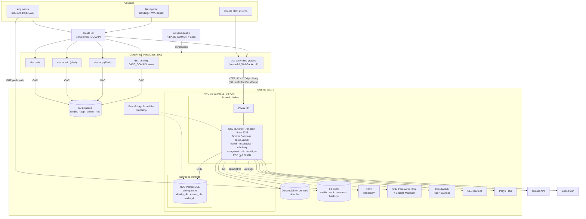
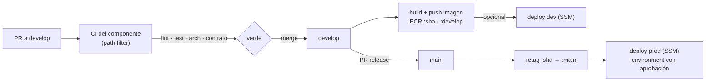
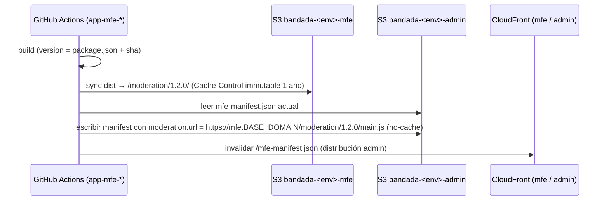

# Infraestructura — Bandada U

> **Estado (2026-10-15).** El entorno **local** (§2: Docker Compose + Traefik) está **implementado y verificado** en
> `bandadau-infra` (`make up && make seed && make smoke`). Diferencias reales respecto a este diseño:
> - Un solo `docker-compose.yaml` en la raíz de `bandadau-infra` (no `compose/`), con perfiles `infra`, `services`,
>   `observability` y `llm`.
> - MongoDB fijado en `mongo:8.0.19` (las 8.0.2x+ no arrancan en el kernel de Docker Desktop, SERVER-121912) y MinIO como
>   `pgsty/minio` (la imagen oficial ya no se publica). n8n usa SQLite en un volumen.
> - Wallet y notification corren con la misma imagen en roles web / worker / relay
>   (`wallet:consume-commands`, `wallet:relay-outbox`, `notifications:consume`, `notifications:relay-outbox`).
> - Los frontends **no** van en Docker en local: se ejecutan con sus comandos (`pnpm dev`) y Traefik los reenvía desde
>   `host.docker.internal`.
> - Comandos reales: `make setup | up | seed | smoke | mock | down | reset | urls`.
> - **AWS (§4 en adelante, CloudFormation, CI/CD de despliegue) sigue siendo diseño**: `bandadau-infra/aws/` aún no existe.
> Variables por componente: `entornos-y-variables.md`. Decisiones de implementación: ADR-0018.

Cómo se levanta Bandada U en **local** (Docker Compose + Traefik), cómo se despliega la
**demo en AWS** (un host EC2 + servicios gestionados baratos) y cómo funciona el **CI/CD**
por repositorio (ADR-0017). Los nombres de servicios, puertos, imágenes, colas y tablas salen de
`bandadau-docs/docs/03-arquitectura/catalogo-servicios.md` (normativo); este documento **no** los redefine.
Variables de entorno, URLs por entorno y secretos: `entornos-y-variables.md`.

> **Alcance de los estados**: §2 y §3 describen lo implementado (fase 1). §4 (AWS), §6 (backups) y la mayor parte de §5 (CI/CD de despliegue) son **diseño pendiente**
> (`bandadau-infra/aws/` y `bandadau-infra/ci/actions/` no existen). Los componentes de la **fase 2** (insights-service, ollama/Piper, modelos ONNX, dashboards de Grafana,
> ejecución de los workflows de n8n) están marcados "Pendiente fase 2" y su diseño se conserva.

> Inspiración: el repositorio de infraestructura de Homy del mismo equipo (EC2 + RDS + S3 +
> CloudFront, CloudFormation, Secrets Manager, CI en GitHub Actions, *deploy* por SSM, sin ALB
> ni NAT Gateway). Bandada U reutiliza sus ideas en su propio repositorio `bandadau-infra` (como `homy-infra`).

---

## 1. Principios

1. **Un comando**: `make up` levanta todo (RNF-16: < 10 min en una máquina de 16 GB; la fase 1 recomienda ≥ 12 GB asignados a Docker). Primera vez: `cp .env.example .env && make setup && make up && make seed && make smoke`.
2. **Paridad local ↔ AWS** (objetivo; el override de AWS está **pendiente**): el mismo `docker-compose.yaml` (con un *override* de prod) correría en la laptop y
   en el EC2; lo que en local es emulado (DynamoDB Local, MinIO, Mailpit, Postgres en
   contenedor) en AWS se reemplaza por el servicio gestionado **solo cambiando variables**.
3. **Barato**: un host EC2, sin ALB, sin NAT Gateway, sin EKS. CloudFront es el único CDN/edge.
   Objetivo RNF-18 (≤ USD 60/mes) con apagado programado (ver §4.4).
4. **Mínimo privilegio** (RNF-07): un usuario de base de datos por servicio, un usuario de
   RabbitMQ por servicio, políticas IAM por prefijo de tabla/bucket, `/internal/**` bloqueado
   en el gateway.
5. **Dominio parametrizado**: nada tiene el dominio escrito a mano; todo deriva de
   `BASE_DOMAIN` (`bandada.localhost` en local, `bandadau.com` de referencia en prod).
6. **Sin secretos en git**: `.env.example` con valores de desarrollo; en AWS los secretos viven
   en SSM Parameter Store / Secrets Manager (ver `entornos-y-variables.md` §5).

---

## 2. Entorno local (Docker Compose)

> **Estado: implementado (fase 1)**. Un solo archivo `bandadau-infra/docker-compose.yaml` en la **raíz** del repo (no hay carpeta `compose/`), operado con
> el `Makefile` de la misma raíz. Verificado de punta a punta con `make smoke` (26/26). Lo que no existe todavía está marcado "Pendiente fase 2" o "pendiente".

### 2.1 Vista general

```mermaid
flowchart TB
    subgraph host["Laptop (Docker Desktop / OrbStack) - red bridge bandada"]
        TR["traefik :80<br/>dashboard :8080"]
        subgraph svc["perfil services"]
            ID["identity-service :7001"]
            SO["social-service :7002"]
            ME["media-service :7003"]
            EV["events-service :7004"]
            WA["wallet-service :7005<br/>+ wallet-worker + wallet-relay"]
            TI["ticketing-service :7006"]
            NO["notification-service :7007<br/>+ notification-worker + notification-relay"]
            AG["admin-gateway :7010"]
            IN["insights-service :7008<br/>(pendiente fase 2)"]
        end
        subgraph data["perfil infra: datos"]
            PG[("postgres 18.6 :5432")]
            MG[("mongo 8.0.19 rs0 :27017")]
            DY[("dynamodb-local :8000")]
            MQ{{"rabbitmq 4.2.9-management<br/>:5672 / :15672"}}
            S3[("minio pgsty :9000 / :9001")]
        end
        subgraph ops["perfil infra: operación"]
            N8N["n8n 2.43.5 (SQLite) :5678"]
            MP["mailpit :8025 / :1025"]
        end
        subgraph obs["perfiles opcionales"]
            LGTM["otel-lgtm (observability)<br/>Grafana :3300 · OTLP :4317/:4318"]
            OL["ollama (llm, pendiente fase 2)"]
        end
    end
    subgraph hostapps["Procesos en el host (pnpm dev)"]
        LA["landing :3000"]
        SH["admin-shell :3001"]
        M1["mfe-moderation :4201"]
        M2["mfe-insights :4301"]
        MO["mobile (Metro / web) :8081"]
    end
    TR --> ID & SO & ME & EV & WA & TI & NO & AG
    TR -.502 hasta la fase 2.-> IN
    TR -->|host.docker.internal| LA & SH & M1 & M2 & MO
    ID & EV & WA --> PG
    SO & ME --> MG
    SO & ME & EV & WA & TI & NO --> DY
    ME --> S3
    ID & SO & ME & EV & WA & TI & NO & AG <--> MQ
    MQ <--> N8N
    ID & N8N & NO --> MP
    ID & SO & ME & EV & WA & TI & NO & AG -.OTLP opcional.-> LGTM
```



### 2.2 Perfiles de Compose

Un solo proyecto Compose (`name: bandada`; `COMPOSE_PROJECT_NAME`, o `PROJECT=<otro>` en `make`, para pruebas en paralelo). Cada contenedor de larga
vida pertenece a un **perfil**; `COMPOSE_PROFILES=infra,services` en `.env` define los perfiles por defecto.

| Perfil | Contenedores | Uso típico | Estado |
|---|---|---|---|
| `infra` | `traefik`, `postgres`, `mongo-keyfile` (one-shot), `mongo`, `mongo-init` (one-shot), `dynamodb-local`, `dynamodb-init` (one-shot), `rabbitmq`, `minio`, `minio-init` (one-shot), `mailpit`, `n8n` | Siempre. Base para desarrollar cualquier servicio desde el IDE | Implementado |
| `services` | `identity-service`, `social-service`, `media-service`, `events-service`, `wallet-service` (+ `wallet-worker`, `wallet-relay`), `ticketing-service`, `notification-service` (+ `notification-worker`, `notification-relay`), `admin-gateway` | Probar integraciones / SAGA de punta a punta | Implementado (8 servicios; `insights-service`: **pendiente fase 2**) |
| `observability` | `lgtm` (`grafana/otel-lgtm:0.36.0`) | Grafana + OTLP. **OFF por defecto**: `make up-obs` | Implementado (los dashboards versionados siguen pendientes, ver §2.9) |
| `llm` | *(vacío)* `ollama` (+ `ollama-pull`, `piper`) se definirán en la fase 2 | Agentes sin API de pago | **Pendiente fase 2** (placeholder comentado en el Compose) |
| `apps`, `tools`, `bootstrap` | — | Diseño original (landing/panel/app en Docker, `k6`, `db-bootstrap` de RDS) | **No implementados**: los frontends corren en el host con `pnpm dev`; seed y smoke son scripts Node en el host; k6 y `db-bootstrap` quedan para fases posteriores |

| Comando | Perfiles |
|---|---|
| `make up-infra` | `infra` |
| `make up` | `infra` + `services` (construye las imágenes con `--build` y espera con `scripts/wait-healthy.sh`) |
| `make up-obs` | `infra` + `services` + `observability`, con `OTEL_SDK_DISABLED=false` |
| `make down` / `make reset` | `--profile '*'`: detiene todo / además **borra los volúmenes** (`down -v`) |

> Con `--profile services` sola, Compose rechaza los `depends_on` hacia servicios del perfil `infra`; por eso el `Makefile` usa `infra`+`services` o `'*'`.
> `docker compose up --wait` falla con los one-shot que terminan en 0, de ahí `scripts/wait-healthy.sh`.

> Trabajo diario recomendado: `make up-infra` y correr **en el host** el servicio que se está editando (hot reload) con `make host S=<servicio>`: detiene el contenedor
> y levanta un proxy TCP (`alpine/socat`) con el alias de red del servicio apuntando a `host.docker.internal:<puerto>` (`make unhost S=<servicio>` lo revierte). Así Traefik y
> el resto de contenedores siguen resolviendo `<servicio>:<puerto>`. Los frontends en el host se enrutan por `host.docker.internal` (`extra_hosts` de Traefik).

### 2.3 Redes

Implementado: **una sola red bridge `bandada`** (`<proyecto>_bandada`) compartida por todos los contenedores, con `init: true`, `restart: unless-stopped` y logs
`json-file` rotados (10 MB × 3). La segmentación en cuatro redes del diseño original (`edge`, `backend`, `data`, `ops`) **no se implementó** en la fase 1; sigue siendo
una opción de endurecimiento para AWS (**pendiente**).

Puertos publicados en el host:

| Solo en `127.0.0.1` | En todas las interfaces |
|---|---|
| PostgreSQL `5432`, MongoDB `27017`, DynamoDB Local `8000`, RabbitMQ AMQP `5672` y UI `15672` | Traefik `80`/`8080`, servicios `7001`–`7007` y `7010`, MinIO `9000`/`9001`, Mailpit `8025`/`1025`, n8n `5678`, Grafana/OTLP (con `observability`) |

Sirven para depurar desde el host (DBeaver, Compass, `aws dynamodb --endpoint-url`). Todos son configurables por variable (`entornos-y-variables.md` §3).

### 2.4 Volúmenes

| Volumen | Contenedor | Montaje | Nota |
|---|---|---|---|
| `postgres-data` | postgres | `/var/lib/postgresql` | La imagen `postgres:18` cambió el `PGDATA` a `/var/lib/postgresql/18/docker`: se monta el directorio padre, no `/var/lib/postgresql/data` |
| `mongo-data` | mongo | `/data/db` | |
| `mongo-keyfile` | `mongo-keyfile` (escribe), `mongo` (lee) | `/keyfile` → `/etc/mongo-keyfile` (solo lectura) | *keyFile* requerido por replica set + auth; lo genera el job `mongo-keyfile` la primera vez (`chown 999:999`, `chmod 400`) |
| `dynamodb-data` | dynamodb-local | `/data` (`-sharedDb -dbPath /data`) | El contenedor corre como `root` porque el volumen nombrado nace como root |
| `rabbitmq-data` | rabbitmq | `/var/lib/rabbitmq` | `hostname: rabbitmq` fijo: el nombre del nodo (y por tanto sus datos) debe ser estable entre recreaciones |
| `minio-data` | minio | `/data` | |
| `mailpit-data` | mailpit | `/data` (`MP_DATABASE=/data/mailpit.db`) | |
| `n8n-data` | n8n | `/home/node/.n8n` | **SQLite** propia de n8n (`DB_TYPE=sqlite`, ADR-0016): la instancia Postgres tiene exactamente 3 bases |
| `lgtm-data` | lgtm | `/data` | Solo con `observability` |
| `ollama-models`, `models-cache` | — | — | **Pendiente fase 2** (ollama; caché de ONNX de media/insights) |

`make reset` borra todos los volúmenes del proyecto (`down -v --remove-orphans`; el Makefile no pide confirmación).
Los servicios montan además `./secrets` (identity, lectura/escritura) y `./secrets/qr-es256.pem` (ticketing, solo lectura).

### 2.5 Contenedores de infraestructura (perfil `infra`)

Imágenes con tag exacto (no `latest`); verificado en `docker-compose.yaml`.

| Servicio Compose | Imagen | Puertos host | Healthcheck | Depende de | Memoria |
|---|---|---|---|---|---|
| `traefik` | `traefik:v3.7.14` | `80`, `8080` (dashboard, solo local) | `traefik healthcheck --ping` | — | 128 MB |
| `postgres` | `postgres:18.6` | `127.0.0.1:5432` | `pg_isready` | — | 384 MB |
| `mongo-keyfile` | `mongo:8.0.19` (one-shot) | — | termina con código 0 | — | — |
| `mongo` | `mongo:8.0.19` (`--replSet rs0 --keyFile … --wiredTigerCacheSizeGB 0.25`) | `127.0.0.1:27017` | `mongosh` ping con credenciales de root | `mongo-keyfile` completado | 512 MB |
| `mongo-init` | `mongo:8.0.19` (one-shot) | — | termina con código 0 | `mongo` healthy | — |
| `dynamodb-local` | `amazon/dynamodb-local:3.3.1` | `127.0.0.1:8000` | conexión TCP al puerto (la imagen no trae curl) | — | 384 MB |
| `dynamodb-init` | `amazon/aws-cli:2.38.0` (one-shot) | — | termina con código 0 | `dynamodb-local` healthy | — |
| `rabbitmq` | `rabbitmq:4.2.9-management` | `127.0.0.1:5672`, `127.0.0.1:15672` | `rabbitmq-diagnostics -q ping` | — | 640 MB |
| `minio` | `pgsty/minio:RELEASE.2026-08-04T00-00-00Z` | `9000`, `9001` | `curl /minio/health/live` | — | 256 MB |
| `minio-init` | `pgsty/minio:RELEASE.2026-08-04T00-00-00Z` (one-shot; trae `mc`) | — | termina con código 0 | `minio` healthy | — |
| `mailpit` | `axllent/mailpit:v1.31.5` | `8025`, `1025` | `/mailpit readyz` | — | 128 MB |
| `n8n` | `n8nio/n8n:2.43.5` | `5678` | `wget /healthz` | `rabbitmq`, `mailpit` healthy | 1 GB |
| `lgtm` (perfil `observability`) | `grafana/otel-lgtm:0.36.0` | `3300→3000`, `4317`, `4318` | `curl /api/health` | — | 1.5 GB |
| `ollama` (perfil `llm`) | — | `11434` | — | — | **Pendiente fase 2** |

Decisiones que conviene no redescubrir:

- **MongoDB fijado a 8.0.19**: las versiones 8.0.21+ y 8.3 abortan en kernels Linux ≥ 6.19 (SERVER-121912), p. ej. el de Docker Desktop reciente. No subir la versión sin verificarlo.
- **MinIO usa la imagen comunitaria `pgsty/minio`**: la imagen oficial `minio/minio` ya no se publica; esta trae `mc` y `curl`, por lo que `minio-init` usa la misma imagen.
- **n8n** usa SQLite en su volumen (no Postgres) y arranca con un entrypoint propio que importa credenciales y workflows (§2.8).

### 2.6 Servicios (perfil `services`)

| Servicio Compose | Imagen (`bandada/<svc>:${IMAGE_TAG:-local}`) | Puerto | Healthcheck | `depends_on` (condición) | Memoria |
|---|---|---|---|---|---|
| `identity-service` | `bandada/identity-service` | 7001 | `GET /health/ready` | postgres, rabbitmq, mailpit (healthy) | 512 MB |
| `social-service` | `bandada/social-service` | 7002 | `GET /health/ready` | `mongo-init` y `dynamodb-init` completados, rabbitmq healthy | 256 MB |
| `media-service` | `bandada/media-service` | 7003 | `GET /health/ready` | `mongo-init`, `minio-init`, `dynamodb-init` completados, rabbitmq healthy | 384 MB |
| `events-service` | `bandada/events-service` | 7004 | `GET /health/ready` | postgres, rabbitmq healthy, `dynamodb-init` completado | 512 MB |
| `wallet-service` | `bandada/wallet-service` | 7005 | `GET /health/ready` | postgres, rabbitmq healthy, `dynamodb-init` completado | 256 MB |
| `ticketing-service` | `bandada/ticketing-service` | 7006 | `GET /health/ready` | rabbitmq healthy, `dynamodb-init` completado | 256 MB |
| `notification-service` | `bandada/notification-service` | 7007 | `GET /health/ready` | rabbitmq, mailpit healthy, `dynamodb-init` completado | 256 MB |
| `admin-gateway` | `bandada/admin-gateway` | 7010 | `GET /health/ready` | identity-service healthy (JWKS), rabbitmq healthy | 256 MB |
| `insights-service` | — | 7008 | — | — | **Pendiente fase 2**: sin Dockerfile ni contenedor; Traefik ya enruta hacia él (502) |

- Las imágenes se construyen con el `Dockerfile` **del propio servicio**, en el repo hermano `bandadau-backend`: identity, events, wallet y notification con
  `build.context: ../bandadau-backend/services/<x>`; los servicios Node (social, media, ticketing, admin-gateway) con `context: ../bandadau-backend`,
  `dockerfile: services/<x>/Dockerfile` y `additional_contexts: { shared: ../bandadau-shared }` (para los paquetes `@bandada/*`). `make setup` compila antes `bandadau-shared`.
- Healthcheck común: `wget -qO- http://127.0.0.1:<puerto>/health/ready` o, si no hay `wget`, `curl -fsS`; `interval` 10 s, `retries` 6, `start_period` 60 s para Spring y 20 s para el resto.
- **Procesos auxiliares (misma imagen, otro `command`)**: en los servicios Laravel el consumidor y el relay del outbox son comandos artisan de larga vida (`eventos-y-mensajeria.md` §6),
  declarados como contenedores extra sin puerto HTTP, con las **mismas variables** que el servicio web y `depends_on: <servicio> healthy`:

  | Contenedor | Comando por defecto (variable que lo sobreescribe) | Función |
  |---|---|---|
  | `wallet-worker` | `php artisan wallet:consume-commands` (`WALLET_WORKER_CMD`) | Consume `wallet-service.commands` (SAGA) |
  | `wallet-relay` | `php artisan wallet:relay-outbox` (`WALLET_RELAY_CMD`) | Outbox → RabbitMQ, expiración de recargas y purga |
  | `notification-worker` | `php artisan notifications:consume` (`NOTIFICATION_WORKER_CMD`) | Consume `notification-service.events` |
  | `notification-relay` | `php artisan notifications:relay-outbox` (`NOTIFICATION_RELAY_CMD`) | Inactivo: el servicio no publica eventos; existe para que el Compose sea sano y puede omitirse |

  Su healthcheck no es HTTP: `grep -qa artisan /proc/1/cmdline` (el proceso artisan sigue siendo el PID 1; `interval` 30 s). En Spring y NestJS el consumidor y el relay
  corren dentro del mismo proceso del servicio.
- Los servicios **no** dependen entre sí en el arranque (salvo `admin-gateway` → identity por JWKS): la degradación elegante (RNF-03) se prueba apagando contenedores.
- Variables comunes por ancla YAML (`x-service-env`) más un ancla por stack (`x-java-env`, `x-node-env`, `x-laravel-env`); el detalle está en `entornos-y-variables.md` §4.
  No se usa `env_file` por servicio.

### 2.7 Traefik (gateway)

- Configuración estática en `bandadau-infra/traefik/traefik.yml`: *entrypoints* `web` (`:80`) y `traefik` (`:8080`: dashboard con `api.insecure: true` solo en local, y `ping`),
  **solo proveedor *file*** (`bandadau-infra/traefik/dynamic/{routers,middlewares}.yml`, con `watch`; no se usa el proveedor Docker ni *labels*), *access log* JSON filtrado a los
  códigos 400–599. El dominio sale de `{{ env "BASE_DOMAIN" }}` (variable de entorno del contenedor). `websecure`/TLS y las métricas OTLP de Traefik: **pendiente** (AWS, §4).
- Enrutamiento por `Host` + `PathPrefix` exactamente como el catálogo §4, con `BASE_DOMAIN`:

| Router | Regla | Servicio | Cadena de middlewares |
|---|---|---|---|
| `api-internal-block` | `Host(api.*) && (PathPrefix(/internal) \|\| PathPrefix(/api/v1/auth/service-token))`, prioridad 10000 | `noop@internal` | `deny-all` → **403** |
| `identity-auth` | `Host(api.*) && PathPrefix(/api/v1/auth)`, prioridad 200 | identity-service:7001 | `api-auth-chain` |
| `identity` | `… PathPrefix(/api/v1/users\|universities\|/.well-known)` | identity-service:7001 | `api-chain` |
| `social` | `… PathPrefix(/api/v1/profiles\|posts\|feed\|groups\|follows\|reports)` | social-service:7002 | `api-chain` |
| `media` | `/api/v1/media` | media-service:7003 | `api-chain` |
| `events` | `/api/v1/events`, `/api/v1/registrations` | events-service:7004 | `api-chain` |
| `wallet` | `/api/v1/wallet` | wallet-service:7005 | `api-chain` |
| `ticketing` | `/api/v1/tickets` | ticketing-service:7006 | `api-chain` |
| `notification` | `/api/v1/notifications`, `/api/v1/devices` | notification-service:7007 | `api-chain` |
| `insights` | `/api/v1/insights`, `/mcp` | insights-service:7008 | `api-chain`; **502 hasta la fase 2** |
| `graphql` | `/graphql` (HTTP + WebSocket `graphql-ws`) | admin-gateway:7010 | `cors`, `ratelimit-default`, `secure-headers` (sin `compress`, para no interferir con el *upgrade*) |
| `landing` | `Host(${BASE_DOMAIN}) \|\| Host(www.${BASE_DOMAIN})` | `host.docker.internal:3000` | — |
| `app` | `Host(app.${BASE_DOMAIN})` | `host.docker.internal:8081` | — |
| `admin-shell` | `Host(admin.${BASE_DOMAIN})` | `host.docker.internal:3001` | — |
| `mfe-moderation` / `mfe-insights` | `Host(mfe.${BASE_DOMAIN}) && PathPrefix(/moderation)` / `/insights` | `host.docker.internal:4201` / `:4301` | `cors` |
| `s3` | `Host(s3.${BASE_DOMAIN})` | minio:9000 (URLs prefirmadas) | — |
| `n8n`, `mailpit`, `rabbitmq`, `grafana`, `minio-console` | `Host(n8n.*)`, `mail.*`, `rabbit.*`, `grafana.*`, `minio.*` | n8n:5678, mailpit:8025, rabbitmq:15672, lgtm:3000, minio:9001 | — |

- **Middlewares** (`bandadau-infra/traefik/dynamic/middlewares.yml`):
  - `cors` — **CORS con credenciales**: `accessControlAllowCredentials: true`, por lo que los orígenes se declaran **explícitos** con expresiones regulares (nunca `*`):
    `^http://localhost:(3000|3001|4201|8081)$`, `^http://127\.0\.0\.1:(3000|3001|4201|8081)$` y `^https?://([a-z0-9-]+\.)?<BASE_DOMAIN>$`. Métodos `GET, POST, PUT, PATCH, DELETE, OPTIONS`.
    Cabeceras permitidas: `Authorization`, `Content-Type`, `Idempotency-Key`, `X-Correlation-Id`, `traceparent`, `tracestate`, `Accept-Language` y **`X-Bandada-Client`**.
    Cabeceras expuestas: `Idempotent-Replayed`, `Content-Language`, `X-Correlation-Id`, `Location`, `Retry-After`, `X-Unread-Count`. `maxAge` 600 s, `Vary` activado.
    Traefik **sobrescribe** `Access-Control-Allow-Origin` en el camino `api.*` (si el servicio añade CORS propio, no se duplica).
  - `ratelimit-default` (100/s, ráfaga 200) y `ratelimit-auth` (60/min, ráfaga 40): límites de **desarrollo**; la regla de prod (10/min/IP en `/api/v1/auth/*`, RNF-06) está **pendiente**.
  - `secure-headers` (`nosniff`, `X-Frame-Options: DENY`, `Referrer-Policy`), `compress`, `deny-all` (`ipAllowList` con un rango inalcanzable: responde 403).
  - Cadenas: `api-chain` = `cors` + `ratelimit-default` + `secure-headers` + `compress`; `api-auth-chain` = lo mismo con `ratelimit-auth`.
  - **Pendiente**: `correlation-id` (el `X-Correlation-Id` lo propaga cada servicio), `ops-auth` (basic auth para n8n/Grafana en prod) y la verificación `X-Origin-Verify` de CloudFront.
- `*.localhost` resuelve a `127.0.0.1` en Chrome/Firefox/macOS; en Safari o Linux, `make setup` imprime la línea de `/etc/hosts` a agregar. Para el teléfono físico se usa la IP LAN
  (`EXPO_PUBLIC_API_URL`).

### 2.8 Inicialización de datos

#### PostgreSQL — 3 bases, 3 usuarios

`bandadau-infra/postgres/init/01-create-databases.sh` (montado en `/docker-entrypoint-initdb.d/`, solo corre con el volumen vacío). Las contraseñas llegan por variables
(`IDENTITY_DB_PASSWORD`, `EVENTS_DB_PASSWORD`, `WALLET_DB_PASSWORD`). Es idempotente (`CREATE ROLE`/`CREATE DATABASE` condicionales con `\gexec`; reaplica la contraseña).

```sql
-- por cada par (identity|events|wallet):
CREATE ROLE identity LOGIN PASSWORD :'pw';          -- si no existe
CREATE DATABASE identity_db OWNER identity;         -- si no existe
REVOKE CONNECT ON DATABASE identity_db FROM PUBLIC;
GRANT CONNECT ON DATABASE identity_db TO identity;
-- dentro de identity_db:
REVOKE ALL ON SCHEMA public FROM PUBLIC;
ALTER SCHEMA public OWNER TO identity;
```

- La instancia contiene **exactamente 3 bases** (`identity_db`, `events_db`, `wallet_db`): n8n no usa Postgres (SQLite propia).
- Los esquemas los crea **cada servicio** con sus migraciones (Flyway en identity y events; migraciones de Laravel en wallet al arrancar el rol `web`); el init solo crea bases y usuarios.
- En RDS no existe `docker-entrypoint-initdb.d`: el mismo script se ejecutaría una vez con un contenedor `db-bootstrap` usando el usuario maestro (**pendiente**, junto con AWS).

#### MongoDB — replica set `rs0`

- `mongo-keyfile` (one-shot) genera el keyfile en el volumen `mongo-keyfile`. `mongo` arranca con `--replSet rs0 --bind_ip_all --keyFile /etc/mongo-keyfile/key` y usuario raíz
  (`MONGO_INITDB_ROOT_*`); imagen fijada a `8.0.19` (SERVER-121912).
- `mongo-init` (one-shot, `bandadau-infra/mongo/init/{init.sh,init-replica.js,create-users.js}`), idempotente:
  1. Espera a `mongod`, inicia `rs0` (1 nodo, miembro anunciado `mongo:27017`) si no existe y espera a `PRIMARY`.
  2. Crea o actualiza los usuarios `social` (`readWrite` sobre la base `social`) y `media` (`readWrite` sobre `media`).
  3. No crea índices: cada servicio los asegura al arrancar (`createIndexes` idempotente).
- Desde el host, conectarse con `mongodb://…@localhost:27017/?directConnection=true` (el miembro del rs se anuncia como `mongo:27017`).

#### DynamoDB Local — tablas

`bandadau-infra/dynamodb/tables/*.json` (formato de entrada de `aws dynamodb create-table`), `dynamodb/ttl.txt` y el script `dynamodb/create-tables.sh` que ejecuta `dynamodb-init`:

| Archivo | Tabla | Claves | GSIs | TTL |
|---|---|---|---|---|
| `idempotency.json` | `bandada-idempotency` | `pk` (S) | — | `expiresAt` |
| `ticketing.json` | `bandada-ticketing` | `pk` (S), `sk` (S) | `GSI1` (`gsi1pk`,`gsi1sk`), `GSI2` (`gsi2pk`,`gsi2sk`) | `expiresAt` |
| `notifications.json` | `bandada-notifications` | `pk`, `sk` | `GSI1` (`gsi1pk`,`gsi1sk`) | `expiresAt` |
| `insights.json` | `bandada-insights` | `pk`, `sk` | `GSI1` (`gsi1pk`,`gsi1sk`) — ver propuesta en `06-modelo-estatico/insights.md` | `expiresAt` (la tabla ya existe; el servicio es **pendiente fase 2**) |

- Imagen `amazon/dynamodb-local:3.3.1` con `-sharedDb -dbPath /data` (persistente en el volumen `dynamodb-data`). Modo de facturación `PAY_PER_REQUEST` (igual al de AWS) para que los mismos
  JSON sirvan para CloudFormation.
- El script es idempotente (`describe-table` antes de `create-table`) y luego activa el TTL leyendo `ttl.txt` (las **cuatro** tablas con `expiresAt`). **DynamoDB Local no garantiza el
  borrado por TTL**: el código siempre filtra por `expiresAt` además de confiar en el TTL.
- Credenciales ficticias en local (`AWS_ACCESS_KEY_ID=local`, región `us-east-1`).
- **Ítems técnicos de inbox/outbox** (en la tabla de cada servicio, `pk`/`sk`; `idempotencia.md`):

  | Ítem | Clave | Quién lo escribe | Notas |
  |---|---|---|---|
  | Outbox (publicaciones) | `pk = OUTBOX#<id>`, `sk = META`; los pendientes se listan por `GSI1` con `gsi1pk = OUTBOX#PENDING` | `@bandada/messaging-ts` (`DynamoOutbox`; lo usa ticketing-service) | Se reclama con *lease* y se borra al publicar |
  | Inbox (mensajes procesados) | `pk = INBOX#<messageId>`, `sk = META` | `@bandada/messaging-ts` (ticketing) y `DynamoNotificationRepository` (notification; también `INBOX#group:<key>`) | TTL de 14 días en notification; el inbox y la escritura de negocio van en la misma `TransactWriteItems` |
  | Entidades de ticketing | `TICKET#<ticketId>`/`META` (con `GSI1 = USER#<u>`/`STARTS#<fecha>#<id>` y `GSI2 = REG#<regId>`/`TICKET#<id>`), `REG#<registrationId>`/`LOCK` | ticketing-service | |
  | Entidades de notification | `USER#<u>`/`NOTIF#<uuidv7>` (TTL `expiresAt`), `USER#<u>`/`PREF` (preferencias y `unreadCount`) | notification-service | |

  Según el diseño (`idempotencia.md`), los servicios con Postgres (identity, events, wallet) y Mongo (social, media) guardan su inbox/outbox en su propia base (`database per service`); no verificado en detalle para cada uno.

#### MinIO — buckets

`minio-init` (`bandadau-infra/minio/init.sh`) con `mc`, idempotente:

| Bucket | Uso | Política |
|---|---|---|
| `bandada-media` | Fotos/videos de usuarios (`uploads/<ownerId>/<mediaId>/original`, `…/thumb.jpg`, `…/frames/`) | privado; acceso solo por URL prefirmada (RNF-08) |
| `bandada-reports` | Audios de reportes generativos (`reports/<reportId>.mp3`) | privado (lo usará insights: fase 2) |
| `bandada-models` | Modelos ONNX `models/<nombre>/<versión>/model.onnx` | privado; lectura por media/insights |
| `bandada-public` | Modelos on-device descargables por la app (`mobile/…`) y portadas públicas de eventos | lectura anónima (`mc anonymous set download`; solo local; en AWS va detrás de CloudFront) |

Además crea los usuarios MinIO `media-svc` e `insights-svc` con políticas por bucket (`media-svc-policy`, `insights-svc-policy`; simulan IAM). El CORS del API S3 (PUT prefirmado
desde la app web y el panel) se configura con `MINIO_API_CORS_ALLOW_ORIGIN=${CORS_ORIGINS}` (MinIO no usa CORS por bucket). Las URLs prefirmadas se firman con
`S3_PUBLIC_ENDPOINT=http://localhost:9000` (path-style) y duran `UPLOAD_URL_TTL_SECONDS`. `make models-sync` (subir los ONNX de `bandadau-ml/`): **pendiente fase 2**.

#### RabbitMQ — `definitions.json`

`bandadau-infra/rabbitmq/definitions.json` (versionado) se carga al arrancar (`load_definitions` en `bandadau-infra/rabbitmq/rabbitmq.conf`, montado en
`/etc/rabbitmq/conf.d/20-bandada.conf`). Lo genera `bandadau-infra/rabbitmq/render-definitions.sh` (`make rabbit-defs`; `make setup`/`up` lo ejecutan) a partir de
`definitions.template.json` sustituyendo las contraseñas de `bandadau-infra/.env`. **En local van en claro** en el JSON y RabbitMQ las hashea al importar (solo desarrollo).
Imagen `rabbitmq:4.2.9-management`.

- **vhost**: `/` (por defecto; las URLs de los servicios no indican vhost).
- **Exchanges** (durables, `topic`): `bandada.events`, `bandada.commands`, `bandada.dlx`.
- **Colas principales** (quorum, durables), exactamente las del catálogo §5: `events-service.saga-replies`, `wallet-service.commands`, `ticketing-service.commands`,
  `social-service.events`, `media-service.events`, `notification-service.events`, `insights-service.analytics`, `n8n.automation`. Cada una con
  `x-dead-letter-exchange: bandada.dlx`, `x-dead-letter-routing-key: <nombre-de-la-cola>` y **`x-delivery-limit: 10`** (corta bucles de *poison messages* si el consumidor muere antes del ack).
- **Reintentos con espera** (3 por cola principal): `<q>.retry.5s`, `<q>.retry.30s` y `<q>.retry.5m` — colas *classic* con `x-message-ttl` de 5 000 / 30 000 / 300 000 ms,
  `x-dead-letter-exchange: ""` (exchange por defecto) y `x-dead-letter-routing-key: <q>`: al expirar el TTL el mensaje vuelve a la cola principal. El consumidor republica la copia con
  `x-retry-count` y, agotados los 3 intentos, hace `nack` sin requeue (→ DLQ).
- **DLQ**: una cola `<q>.dlq` (quorum) por cola principal, enlazada a `bandada.dlx` con el nombre de la cola principal como routing key (así la DLQ sabe de qué cola vino cada mensaje y el agente
  de monitoreo puede contarlas por servicio).
- **Policies** (en lugar de argumentos, para no romper la declaración idempotente del dueño de la cola): `cap-unconsumed` (`n8n.automation` e `insights-service.analytics`, sin consumidor en la fase 1)
  y `cap-dlq` (`*.dlq`), ambas con `max-length` 10 000 y `overflow: drop-head`.
- **Bindings** (33): los del catálogo §5 (comandos sobre `bandada.commands`, el resto sobre `bandada.events`, más los de las DLQ sobre `bandada.dlx`). Los servicios **no crean** esta topología: la
  **verifican** (declaración pasiva) y, si la declaran (`RABBIT_DECLARE_TOPOLOGY`/`RABBITMQ_DECLARE_TOPOLOGY`, solo dev/tests), deben usar exactamente estos argumentos. Detalle en
  `bandadau-docs/docs/03-arquitectura/eventos-y-mensajeria.md`.
- **Cola dinámica fuera de `definitions.json`**: `admin-gateway.subscriptions.<instanceId>` la declara el propio admin-gateway al arrancar (**exclusiva y auto-delete**, una por instancia; ADR-0016,
  catálogo §5) para alimentar las subscriptions GraphQL; desaparece al cerrarse la conexión.
- **Usuarios** (en local): `bandada` (usuario compartido de los servicios, permisos `.*`), `n8n` (permisos `.*`), `monitor` (tag `monitoring`, solo lectura: `configure/write ^$`, `read .*`) y
  `admin` (tag `administrator`, para la UI). En AWS (RNF-07) el diseño prevé un usuario por servicio con permisos `configure: ^$`, `write` sobre los exchanges que publica y `read` sobre su cola
  (**pendiente**).

#### n8n

- Imagen `n8nio/n8n:2.43.5` con **SQLite** en el volumen `n8n-data` (`DB_TYPE=sqlite`), `N8N_ENCRYPTION_KEY` fijo (si cambia, se pierden las credenciales guardadas), zona horaria `America/La_Paz`,
  purga de ejecuciones a las 168 h. Propietario gestionado por variables si hay `N8N_OWNER_PASSWORD_HASH` (si no, se crea desde la UI).
- Entrypoint propio (`bandadau-infra/n8n/scripts/entrypoint.sh`, montado en `/import/scripts`): renderiza las credenciales desde variables (`render-credentials.mjs` + `n8n/credentials/*.json.tpl`),
  las importa con `n8n import:credentials`, importa los workflows (`n8n import:workflow --separate`), **publica** los que traen `"active": true` (`n8n publish:workflow`) y arranca `n8n start`.
  Verificado contra n8n 2.43.5. No existen los objetivos `make n8n-import` / `make n8n-export` del diseño original.
- Workflows **versionados en git** en `bandadau-infra/n8n/workflows/`: `wf-00-router` … `wf-06-difusion-evento`, y los de apoyo `wf-90-service-token`, `wf-91-dedupe`, `wf-99-error-handler`. Son de la
  **fase 2** (dependen de `insights-service`, de la cola `n8n.automation` y de los reportes generativos); en la fase 1 el contenedor arranca y es sano, pero la ejecución de punta a punta de los
  workflows no está verificada.
- Credenciales siempre por variables de entorno (RabbitMQ `n8n`, SMTP Mailpit, token de servicio para REST interno, bot de Telegram opcional). Detalle de workflows en
  `bandadau-docs/docs/03-arquitectura/automatizacion-n8n.md` (D10).
- `n8n` comparte la red `bandada` con todo: llama `/internal/v1/**` con token de servicio y consume `n8n.automation`.

### 2.9 Observabilidad local

**Implementado parcialmente.** El perfil `observability` levanta `grafana/otel-lgtm:0.36.0` (Grafana + Loki + Tempo + Prometheus/Mimir + colector OTel; Grafana en `:3300`, OTLP en `:4317`/`:4318`,
`GRAFANA_ADMIN_USER`/`GRAFANA_ADMIN_PASSWORD` = `admin`/`admin`) con `make up-obs`, que además pone `OTEL_SDK_DISABLED=false` en los servicios. Sin ese perfil los servicios dejan
`OTEL_SDK_DISABLED=true` (no hay colector).

- **Pendiente**: los dashboards versionados en `bandadau-infra/observability/dashboards/` (SAGA, colas/DLQ, latencias; la carpeta `observability/` está vacía) y su aprovisionamiento por montaje.
- Algunos servicios (identity, wallet, notification) declaran en su `.env.example` que en la fase 1 **no incluyen exportador OTLP** y solo propagan `traceparent`: las trazas completas dependen de su
  implementación. Ver `bandadau-docs/docs/03-arquitectura/observabilidad.md`.

### 2.10 Datos de demo, humo y gateway mock

- `make seed` (`node seed/seed.mjs`, Node ESM sin dependencias, **se ejecuta en el host** contra los puertos publicados; no es un contenedor): llama a las **APIs** (nunca escribe en bases ajenas):
  universidades UMSA y UCB, los usuarios demo (`admin`, `mod`, `org`, `org2`, `lucia`, `marco`), roles por `PATCH /internal/v1/users/{id}/roles` con token de servicio (cliente `bandada-seed`, directo por `localhost:7001`),
  créditos de Lucía, un grupo, 3 posts y 3 eventos. Idempotente. Contraseña de desarrollo `Bandada#2026`; credenciales en `bandadau-infra/README.md` (solo dev).
- `make smoke` (`node smoke/smoke.mjs`): recorre registro → verificación (código leído de Mailpit) → login → post → recarga idempotente → inscripción pagada con ticket ES256 verificado → `ALREADY_REGISTERED`
  → notificación → `EVENT_FULL` → **caos** (recrea `ticketing-service` con `CHAOS_TICKETING_FAIL=true`, comprueba la compensación y lo restaura) → moderador y GraphQL (+ RBAC). 26 comprobaciones; sale ≠ 0 si
  falla alguna. Opciones: `SMOKE_CHAOS=0` o `--no-chaos`, `--only=chaos`.
- `make mock` / `make mock-stop` / `make mock-test`: **gateway mock** (Node 24, sin Docker) en `http://localhost:4010` que imita REST `/api/v1` y GraphQL `/graphql` a partir de `bandadau-docs/contracts/`,
  para desarrollar frontends sin backend (`bandadau-infra/mock/README.md`).
- `make check-infra` (`scripts/check-infra.sh`): verifica el perfil `infra` levantado (salud, topología de RabbitMQ, bases, tablas, buckets, UIs y rutas de Traefik). `make validate`: `docker compose config`,
  sintaxis de scripts y de seed/smoke.
- `make load` (`k6`, `bandadau-infra/load/`): **pendiente** (no existe todavía).

---

## 3. Estructura de la carpeta `bandadau-infra/`

Estado real (fase 1). Lo marcado *(pendiente)* no existe todavía.

```
bandadau-infra/
├── AGENTS.md  CLAUDE.md  README.md
├── .env.example                  # BASE_DOMAIN, COMPOSE_PROFILES, contraseñas dev, puertos, flags de caos (CHAOS_*), variables de servicios y n8n
├── Makefile                      # punto de entrada: make setup, up, up-infra, up-obs, seed, smoke… (se ejecuta desde bandadau-infra/)
├── docker-compose.yaml           # un solo archivo: perfiles infra, services, observability, llm (placeholder)
├── traefik/
│   ├── traefik.yml               # estático
│   └── dynamic/{routers,middlewares}.yml   # file provider; dominio por {{ env "BASE_DOMAIN" }}
├── postgres/init/01-create-databases.sh
├── mongo/init/{init.sh,init-replica.js,create-users.js}   # el keyfile lo crea el job mongo-keyfile
├── dynamodb/{create-tables.sh,ttl.txt,tables/*.json}
├── rabbitmq/{rabbitmq.conf,definitions.template.json,definitions.json,render-definitions.sh}
├── minio/init.sh
├── n8n/                          # workflows JSON (wf-00…wf-06, 90, 91, 99), credentials/*.json.tpl, scripts/{entrypoint.sh,render-credentials.mjs}
├── secrets/                      # PEM de desarrollo (git-ignored; los genera make keys)
├── scripts/                      # gen-keys.sh, wait-healthy.sh, check-infra.sh, host-upstream.sh, clone-all.sh, create-github-repos.sh
├── seed/                         # seed.mjs + lib/ (Node ESM, llaman a las APIs)
├── smoke/smoke.mjs               # humo de la fase 1
├── mock/                         # gateway mock (REST + GraphQL) sin Docker
├── observability/                # (vacía) dashboards y alertas: pendiente
├── ci/templates/                 # plantillas de GitHub Actions por repo (bandadau-<repo>.yml → <repo>/.github/workflows/ci.yml)
├── .github/workflows/ci.yml      # CI de este repo
├── load/                         # k6 (pendiente)
├── aws/                          # CloudFormation y scripts de despliegue (pendiente, ver §4)
│   ├── cloudformation/{network,data,compute,edge,ci,scheduler}.yaml
│   ├── params/{dev,prod}.env.example
│   └── scripts/{deploy-stack.sh,host-deploy.sh,render-env.sh,deploy-static.sh,backup-mongo.sh}
└── ci/actions/                   # composite actions reutilizables: docker-build-push, ssm-deploy, static-deploy (pendiente)
```

Los workflows reales viven en el `.github/workflows/` **de cada repositorio** (GitHub solo los lee de ahí); `bandadau-infra/ci/` guarda las plantillas y, a futuro, las piezas reutilizables.

---

## 4. AWS — demo

> **Estado: diseño pendiente** (fase posterior a la 1). No existe `bandadau-infra/aws/` ni `bandadau-infra/compose/prod.yaml`; las referencias a `compose.yaml` y `prod.yaml` de esta
> sección describen el diseño objetivo, que partirá del `docker-compose.yaml` actual. Al llevarlo a AWS hay que verificar la imagen de MongoDB (local fijada a `8.0.19`, SERVER-121912),
> la de MinIO (solo local) y la versión de PostgreSQL disponible en RDS.

### 4.1 Diagrama de despliegue



### 4.2 Decisiones

| Tema | Decisión | Motivo |
|---|---|---|
| Cómputo | **1 EC2 `t3.xlarge`** (4 vCPU, 16 GB) con Docker Compose (`compose.yaml` + `prod.yaml`) | 9 servicios (2 JVM, 2 PHP-FPM, 5 Node) + RabbitMQ + Mongo + n8n + LGTM caben en 16 GB; igual que Homy, sin ECS/EKS |
| Ingreso | CloudFront → EIP del EC2 por HTTP :80, Traefik enruta por `Host` | TLS gratis con ACM en CloudFront, sin ALB (~USD 18/mes ahorrados). El SG del EC2 solo admite la *managed prefix list* `com.amazonaws.global.cloudfront.origin-facing` en :80 y Traefik exige la cabecera secreta `X-Origin-Verify` |
| API en CloudFront | *Cache policy* `CachingDisabled` + *origin request policy* `AllViewer` (reenvía `Host`, cabeceras, *query* y cookies); origen = `origin.${BASE_DOMAIN}` → EIP | Traefik necesita el `Host` (`api.`, `n8n.`, `grafana.`); WebSockets (`graphql-ws`) y *streaming* (MCP Streamable HTTP) funcionan en CloudFront |
| Postgres | **RDS PostgreSQL** `db.t4g.micro`, 20 GB gp3, Single-AZ, en subred privada | Gestionado y en capa gratuita el primer año si la cuenta califica; 3 bases + 3 usuarios creados por `db-bootstrap`. Versión 18 si RDS la ofrece; si no, la mayor disponible (verificar) |
| MongoDB | Contenedor `mongo:8` rs0 en el EC2 con volumen EBS + `mongodump` diario a S3 | Costo cero. **Alternativa**: MongoDB Atlas **M0** (gratis, 512 MB, replica set de 3 nodos → transacciones OK; sin backups ni métricas avanzadas, límite de conexiones) — libera ~1 GB de RAM del EC2 |
| DynamoDB | 4 tablas `PAY_PER_REQUEST` (mismos JSON que en local) | Céntimos al mes con tráfico de demo; PITR solo en `bandada-ticketing` |
| Object storage | S3: `bandada-<env>-media`, `-reports`, `-models`, `-backups` (privados, cifrado SSE-S3, *Block Public Access*) | URLs prefirmadas 15 min (RNF-08); CORS para `PUT` desde `app.` |
| Estáticos | S3 por sitio + CloudFront con **OAC**: `landing`, `app`, `admin`, `mfe` | Patrón Homy: HTML `no-cache`, assets con *hash* `max-age=31536000, immutable` |
| DNS/TLS | Route 53 (zona `BASE_DOMAIN`) + ACM en **us-east-1** (`BASE_DOMAIN`, `*.BASE_DOMAIN`; en dev además `*.dev.BASE_DOMAIN`) | Requisito de CloudFront |
| Secretos | SSM Parameter Store `SecureString` (gratis) para casi todo; Secrets Manager solo para la contraseña maestra de RDS (gestionada por RDS) y las llaves JWT | Secrets Manager cuesta USD 0.40/secreto/mes |
| Logs/métricas | Driver `awslogs` → CloudWatch (`/bandada/<env>/<servicio>`, retención 14 días) + LGTM en el host para trazas | Alarmas: CPU > 80 %, `StatusCheckFailed` (auto-recover), espacio en disco, 5xx en CloudFront |
| Correo | SES (dominio verificado, DKIM). En demo puede seguir en *sandbox* con destinatarios verificados | Mailpit solo en local |
| TTS / LLM | Polly (voz neural es-US/es-MX y en-US según `locale`) / Claude API | Por uso; costo de demo mínimo |
| Registro de imágenes | **ECR** (`bandada/<componente>`, *lifecycle*: últimas 10 imágenes) | El EC2 hace *pull* con su rol IAM (sin PAT). Alternativa: GHCR |
| Acceso al host | **SSM Session Manager** (sin SSH ni puerto 22 abierto) | Igual que el *deploy* |
| IaC | **CloudFormation** en `bandadau-infra/aws/cloudformation/` (pilas separadas por ciclo de vida) | Mismo enfoque que Homy; `cfn-lint` en CI |

### 4.3 Seguridad de red

| Security group | Entrada | Salida |
|---|---|---|
| `sg-host` (EC2) | :80 desde prefix list de CloudFront | todo (Internet Gateway; sin NAT) |
| `sg-db` (RDS) | :5432 solo desde `sg-host` | — |

- RabbitMQ, Mongo, LGTM, Postgres **no** se publican fuera del host/VPC. n8n y Grafana se
  publican vía CloudFront con `ops-auth` (basic auth en Traefik) + login propio; la alternativa
  más segura es no publicarlos y usar *port forwarding* de Session Manager.
- `/internal/**` → 403 en Traefik también en prod (las llamadas internas van por la red Docker).
- Rol IAM del EC2 con políticas por recurso: `dynamodb:*Item/Query/TransactWriteItems` sobre
  `bandada-*`, `s3:GetObject/PutObject` por bucket, `ssm:GetParametersByPath` sobre
  `/bandada/<env>/*`, `polly:SynthesizeSpeech`, `ses:SendEmail`, `ecr:*Pull*`, `logs:*`.
  Como todos los servicios comparten el host, el mínimo privilegio por servicio se refuerza
  con usuarios distintos de base de datos/broker y prefijos de clave; si se quisiera aislamiento
  IAM por servicio habría que pasar a ECS (fuera de alcance).

### 4.4 Costo estimado (us-east-1, precios de lista orientativos; verificar en la calculadora de AWS)

| Recurso | 24/7 | Con apagado programado (≈ 12 h/día L–V, ~260 h/mes) |
|---|---|---|
| EC2 `t3.xlarge` (USD 0.1664/h) | ~ 121 | ~ 43 |
| EBS gp3 60 GB + snapshots | ~ 6 | ~ 6 |
| IPv4 pública (EIP) | ~ 3.7 | ~ 3.7 |
| RDS `db.t4g.micro` + 20 GB | ~ 14 (0 en capa gratuita) | ~ 6 (detenido fuera de horario; RDS se reinicia solo tras 7 días) |
| DynamoDB on-demand (4 tablas) | < 1 | < 1 |
| S3 + CloudFront (capa gratuita 1 TB) | ~ 1–2 | ~ 1–2 |
| Route 53 (zona) | 0.5 | 0.5 |
| Secrets Manager (2–3 secretos) | ~ 1.2 | ~ 1.2 |
| CloudWatch logs/alarmas | ~ 3 | ~ 2 |
| ECR (≈ 5 GB) | ~ 0.5 | ~ 0.5 |
| SES / Polly / Claude API (demo) | ~ 2–5 | ~ 2–5 |
| **Total aproximado** | **~ USD 150** | **~ USD 65** (≈ 55 con RDS en capa gratuita) |

Alternativas para bajar costo (combinables):

| Alternativa | Ahorro aprox. | Costo / riesgo |
|---|---|---|
| **Apagado programado** (EventBridge Scheduler: EC2 + RDS fuera de horario de trabajo y demo) | −55 % del EC2 | Hay que encender a mano para demos fuera de horario (`make aws-start`) |
| Instancia **Spot** `t3.xlarge` (persistente, *stop* en interrupción) | −60–70 % | Interrupciones; no usar el día de la defensa (cambiar a on-demand) |
| `t3.large` (8 GB) + **MongoDB Atlas M0** + sin LGTM en el host (Grafana Cloud free o solo CloudWatch) + Ollama nunca en prod | −50 % del EC2 | Menos margen de RAM; M0 tiene 512 MB y sin backups |
| Postgres en contenedor en el EC2 en vez de RDS | −14 | Se pierde "gestionado", backups manuales |
| Un solo entorno AWS (sin `dev` permanente; `dev` = local) | −50 % total | Las pruebas en nube se hacen sobre `prod` antes de la demo |
| Savings Plan 1 año | −30–40 % | Compromiso anual (no tiene sentido para un semestre) |

**Recomendación**: un solo entorno AWS (`prod`, rama `main`) con apagado programado
(≈ USD 55–65/mes, cumple RNF-18 en su variante "≤ USD 60" con RDS en capa gratuita), y `dev`
efímero solo en las semanas de integración. Para la semana de la defensa, encendido 24/7
on-demand (≈ USD 35 esa semana).

### 4.5 Arranque del host (user-data) y `deploy`

1. *User-data* (CloudFormation `compute.yaml`): instala Docker + plugin Compose + AWS CLI + jq,
   crea `/opt/bandada/`, descarga `bandadau-infra/compose/*.yaml`, `traefik/`, `rabbitmq/` desde un
   paquete versionado en S3 (`bandada-<env>-backups/releases/infra-<sha>.tgz`), ejecuta
   `render-env.sh` y `docker compose --profile services up -d`.
2. `render-env.sh` lee `ssm get-parameters-by-path /bandada/<env>/` y escribe
   `/opt/bandada/env/<servicio>.env` (`chmod 600`). Igual que en Homy, solo se reescribe si cambió
   un parámetro (evita reinicios innecesarios).
3. `host-deploy.sh <componente> <tag>`: actualiza `IMAGE_TAG_<COMPONENTE>` en
   `/opt/bandada/images.env`, `docker compose pull <svc>`, `up -d --no-deps <svc>`, espera
   `/health/ready` (timeout 120 s); si falla, vuelve al tag anterior y sale con error
   (*rollback* automático).
4. Migraciones: Spring (Flyway) y Laravel (`php artisan migrate --force`) corren al arrancar el
   contenedor; las migraciones deben ser **compatibles hacia atrás** (expand/contract) porque el
   *rollback* no las revierte.

---

## 5. CI/CD (GitHub Actions)

> **Estado**: hoy existe un **`ci.yml` por repositorio** (en `<repo>/.github/workflows/`, copiado de `bandadau-infra/ci/templates/bandadau-<repo>.yml`). Los jobs de `bandadau-infra` son
> `static` (`make validate` + shellcheck), `infra` (`make up-infra` + `make check-infra`) y `stack` (manual/cron: `make setup && make up && make seed && make smoke`); `bandadau-backend`
> separa `node`, `java` y `php`; `bandadau-docs` valida contratos. **Pendiente** (diseño de esta sección): workflows separados por servicio con *path filters* (`svc-*.yml`, `app-*.yml`),
> construcción y *push* de imágenes a ECR, despliegue por SSM, OIDC, EAS y despliegue de estáticos/MFEs (no verificado el detalle de cada `ci.yml`).

### 5.1 Flujo general



### 5.2 Un workflow por componente con *path filters*

Cada repositorio tiene **sus propios** workflows en su `.github/workflows/` (ADR-0017). Dentro de
`bandadau-backend` y `bandadau-admin` se usan *path filters* por servicio o app. Los jobs que necesitan
contratos o paquetes compartidos hacen *checkout* de `bandadau-docs` y `bandadau-shared` como carpetas
hermanas (misma estructura que el workspace local).

| Repo · workflow | `paths` que lo disparan (relativos al repo) | Jobs |
|---|---|---|
| `bandadau-docs` · `contracts.yml` | `contracts/**` | Spectral (OpenAPI), AsyncAPI CLI validate, graphql-inspector (*breaking changes* contra `main`), ajv (MCP); regenera `@bandada/contracts-ts` en un checkout hermano de `bandadau-shared` y avisa si hay diff pendiente |
| `bandadau-backend` · `svc-identity.yml` / `svc-events.yml` | `services/<x>/**` | Gradle: Spotless, Checkstyle, JUnit + Testcontainers, **ArchUnit**, contrato contra `../bandadau-docs/contracts`, build imagen, Trivy, push |
| `bandadau-backend` · `svc-wallet.yml` / `svc-notification.yml` | `services/<x>/**` | Pint, PHPStan/Larastan, Pest, **Deptrac**, contrato, imagen |
| `bandadau-backend` · `svc-social.yml`, `svc-media.yml`, `svc-ticketing.yml`, `svc-insights.yml`, `svc-admin-gateway.yml` | `services/<x>/**` | pnpm (filtro `--filter <x>...`, `@bandada/*` desde el checkout hermano de `bandadau-shared`), ESLint, Jest + Testcontainers, **dependency-cruiser**, imagen |
| `bandadau-landing` · `app-landing.yml` | `**` | lint, `i18n:check`, test, `next build` (export), Lighthouse/axe, deploy estático |
| `bandadau-admin` · `app-admin-shell.yml` | `shell/**` | lint, `i18n:check`, test, `next build` (export), deploy estático |
| `bandadau-admin` · `app-mfe-moderation.yml` | `mfe-moderation/**` | `ng lint`, `ng test`, `i18n:check`, build Elements, deploy MFE |
| `bandadau-admin` · `app-mfe-insights.yml` | `mfe-insights/**` | lint, Vitest, `i18n:check`, `vite build --mode lib`, deploy MFE |
| `bandadau-frontend` · `app-mobile.yml` | `**` | lint, test, `i18n:check`, `expo export -p web` + Lighthouse CI (RNF-10), deploy PWA; EAS Build/Update (§5.4) |
| `bandadau-shared` · `packages.yml` | `packages/**` | build + test de librerías (incl. contraste de `ui-tokens` e `i18n:check`); los consumidores se revalidan en su propio CI |
| `bandadau-ml` · `ml.yml` | `**` | Ruff, pytest; validación ONNX (carga + inferencia de humo); **no** entrena en CI |
| `bandadau-infra` · `n8n.yml` | `n8n/**` | Valida JSON y que no haya credenciales embebidas |
| `bandadau-infra` · `infra.yml` | `**` (excepto `n8n/**`) | `docker compose config --quiet`, `cfn-lint`, `hadolint` en Dockerfiles (checkout hermano de los repos con código), render de `definitions.json` |
| `bandadau-infra` · `e2e-nightly.yml` | cron + manual | checkout de los 8 repos como hermanos, `make up`, `make seed`, pruebas de sistema (SAGA con caos, idempotencia), k6 corto |

- `concurrency: <workflow>-${{ github.ref }}` con `cancel-in-progress` (igual que Homy).
- Autenticación en AWS con **OIDC** (`aws-actions/configure-aws-credentials`, rol
  `bandada-gha-<env>` creado por `ci.yaml`, condicionado a `repo:<org>/<repo>:ref:refs/heads/main|develop`):
  sin llaves de larga duración en GitHub.
- **Imágenes**: `docker/build-push-action` con caché `type=gha`, tags `:<sha>`,
  `:<rama>`; etiqueta OCI `org.opencontainers.image.revision`. Trivy en modo reporte
  (`--exit-code 0` al inicio, `1` para CRITICAL desde R3).
- **Deploy**: composite `bandadau-infra/ci/actions/ssm-deploy` → `aws ssm send-command
  --document-name AWS-RunShellScript --targets Key=tag:bandada:role,Values=host-<env>
  --parameters commands=["/opt/bandada/scripts/host-deploy.sh <svc> <sha>"]` y espera el
  resultado (`aws ssm wait command-executed`). Prod usa un *GitHub Environment* con aprobación
  manual.
- Validación de arquitectura y contrato forman parte del CI (RNF-14, RNF-15); el *job* de
  contrato (Schemathesis contra el servicio levantado en el runner) corre en el workflow del
  servicio.

### 5.3 Despliegue independiente de microfrontends (D5)



- Cada versión del MFE queda **inmutable** en su carpeta; el *rollback* es reescribir el
  manifiesto apuntando a la versión anterior (`make mfe-rollback MFE=moderation V=1.1.0`).
- El *shell* (`admin-shell`) se despliega por separado y **no** se recompila cuando cambia un MFE.
- CORS de la distribución `mfe` permite `admin.${BASE_DOMAIN}`; `crossorigin` en el `<script type="module">`.
- Concurrencia: `concurrency: mfe-manifest-<env>` en ambos workflows de MFE para que dos
  despliegues no se pisen el manifiesto.

### 5.4 App móvil — EAS

| Perfil `eas.json` | Distribución | API | Uso |
|---|---|---|---|
| `development` | interna, *development client* (requerido por los módulos nativos de IA local, no Expo Go) | `EXPO_PUBLIC_API_URL` a la IP LAN o `api.dev.` | Desarrollo diario |
| `preview` | interna (APK Android / ad-hoc iOS) | `api.dev.BASE_DOMAIN` o prod | Pruebas del equipo y docentes |
| `production` | tiendas (opcional) | `api.BASE_DOMAIN` | Release |

- `app-mobile.yml`: en PR solo lint/test/export web. Builds nativos **manuales o por tag**
  `mobile-v*` (`eas build --profile preview --non-interactive`, `EXPO_TOKEN` en secretos de
  GitHub) porque el plan gratuito de EAS tiene cupo mensual de builds. Cambios solo de JS se
  publican con **EAS Update** al canal del perfil.
- Variables `EXPO_PUBLIC_*` se definen por perfil en `eas.json` / *EAS environment variables*;
  son públicas y se hornean en el binario.
- Universal/App Links: `apple-app-site-association` y `assetlinks.json` se publican en
  `https://app.${BASE_DOMAIN}/.well-known/` (bucket `app`) para el salto panel → app (D4).
- La PWA (`expo export -p web` + Workbox) se despliega como un estático más al bucket `app`;
  el *service worker* y `manifest.webmanifest` se suben con `no-cache`.

### 5.5 Estáticos (landing, admin, app web)

`bandadau-infra/aws/scripts/deploy-static.sh <bucket> <dir> <distributionId>` (adaptado de Homy):
sube primero los assets con *hash* (`max-age=31536000, immutable`), luego HTML/JSON/manifest/SW
con `no-cache`, borra objetos huérfanos con `--delete` solo de los no versionados e invalida
`/*.html`, `/`, `/mfe-manifest.json`, `/sw.js`. Las variables `NEXT_PUBLIC_*`/`EXPO_PUBLIC_*`
son de *build*: cambiarlas exige recompilar.

---

## 6. Backups y recuperación

> **Estado: diseño pendiente** (AWS). En local los datos viven en volúmenes con nombre y `make reset` los borra; `make seed` los repuebla.

| Dato | Mecanismo | Retención | Restauración |
|---|---|---|---|
| RDS (identity, events, wallet) | Backups automáticos + PITR; `DeletionPolicy: Snapshot` | 7 días (prod), 1 día (dev) | Restaurar a nueva instancia y cambiar el parámetro SSM del host |
| MongoDB (contenedor) | `backup-mongo.sh` (cron del host 03:00 America/La_Paz): `mongodump --oplog --gzip` → `s3://bandada-<env>-backups/mongo/<fecha>/` | 14 días (lifecycle S3) | `mongorestore --oplogReplay` |
| MongoDB (si Atlas M0) | M0 no tiene backups: mismo `mongodump` programado desde el EC2 | 14 días | ídem |
| DynamoDB | PITR en `bandada-ticketing` (tickets = dinero); las demás se reconstruyen o son efímeras (TTL) | 35 días (PITR) | Restore a tabla nueva + cambio de nombre por parámetro |
| S3 media/audio | Versionado en `media`; *lifecycle* a IA tras 30 días; audio expira a 180 días | — | Versión anterior |
| EBS del host | Data Lifecycle Manager: snapshot semanal | 4 semanas | Nuevo volumen |
| n8n | Workflows en git (`make n8n-export`); volumen incluido en snapshot EBS | — | `make n8n-import` |
| Configuración | Todo en git + SSM (parámetros versionados) | — | Re-ejecutar la pila |

Ensayo de restauración obligatorio antes de la Delivery Review (checklist en
`bandadau-docs/docs/02-iconix/08-revisiones.md`).

---

## 7. Operación rápida

```bash
cd bandadau-infra
cp .env.example .env && make setup   # primera vez: herramientas, corepack/pnpm, build de bandadau-shared, llaves (secrets/), definitions de RabbitMQ
make up                  # infra + 8 servicios (construye imágenes) y espera a que estén healthy
make up-infra            # solo infraestructura (para correr servicios en el IDE)
make up-obs              # + Grafana LGTM y OTLP activado en los servicios
make seed                # datos de demo (idempotente)
make smoke               # humo de la fase 1 (SMOKE_CHAOS=0 omite el caos)
make logs S=events-service   # logs (sin S: todos)
make ps                  # estado y healthchecks
make restart S=<svc>     # reinicia servicios
make build S=<svc>       # reconstruye imágenes (sin S: todas)
make shell-postgres      # shell en un contenedor (make shell-<servicio>)
make host S=identity-service    # redirige un servicio a tu IDE (make unhost S=... lo revierte)
make check-infra         # verifica el perfil infra (salud, colas, bases, tablas, buckets, rutas)
make validate            # compose config + sintaxis de scripts + seed/smoke
make urls                # URLs, puertos y credenciales de demo
make keys                # llaves de desarrollo (JWT RS256, QR ES256) en secrets/
make rabbit-defs         # regenera rabbitmq/definitions.json desde la plantilla y .env
make down                # detiene todo (conserva volúmenes)
make reset               # detiene todo y BORRA los volúmenes (sin confirmación)
make mock                # gateway mock en http://localhost:4010  (make mock-stop · make mock-test)
make clone-all OWNER=<org>   # clona los 8 repos hermanos
```

`PROJECT=<nombre>` cambia el nombre del proyecto Compose (pruebas en paralelo sin tocar el stack principal). La demo de rollback de la SAGA (D2) se activa recreando el contenedor con
`CHAOS_TICKETING_FAIL=true` (variable de **ticketing-service**; el humo lo hace solo) y la de timeout con `CHAOS_WALLET_DELAY_MS` (variable de **wallet-service**): no hay objetivo `make chaos-*`.

**Pendiente** (diseño de AWS y pruebas de carga): `make up-all`, `make svc`, `make rabbit-dlq`, `make load`, `make models-sync`, `make aws-deploy`, `make aws-start` / `make aws-stop`,
`make n8n-import` / `make n8n-export`, `make mfe-rollback`.
