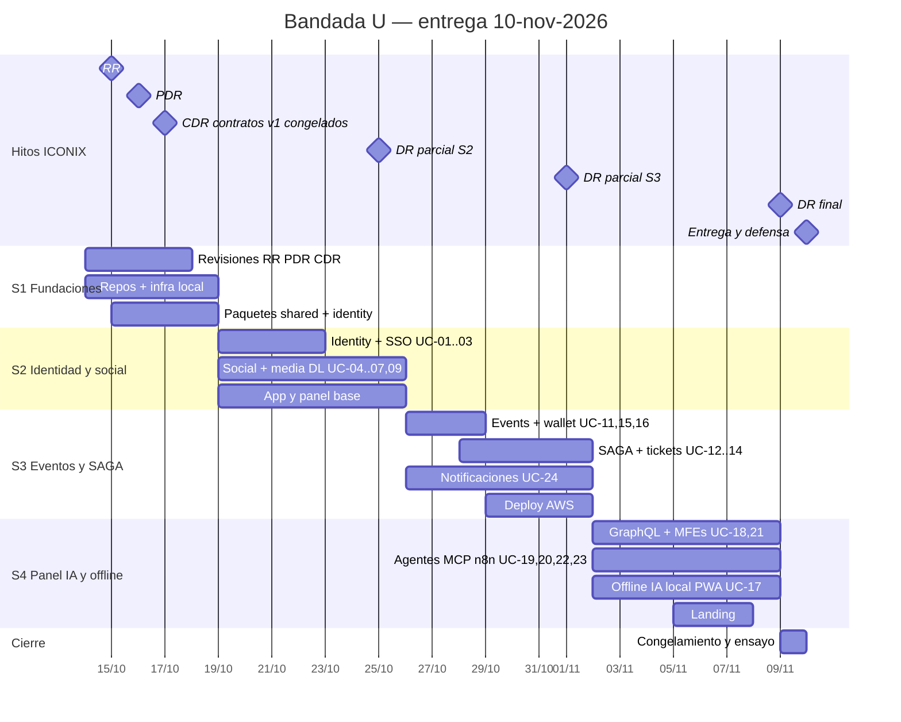
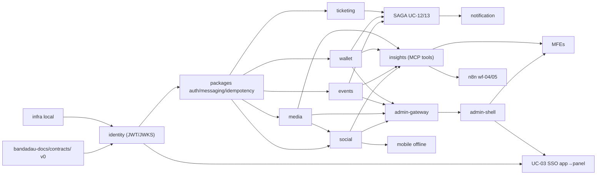

# Roadmap y sprints — Bandada U

> **Entrega y defensa: martes 10 de noviembre de 2026.** Quedan 4 semanas desde el 14 de octubre.

Plan de 5 releases (R0–R4, `bandadau-docs/docs/01-vision/vision-y-alcance.md` §7) comprimidos en
**4 sprints** (S1 corto de 5 días + S2–S4 de 7 días) más 2 días de cierre, con los hitos ICONIX de
`bandadau-docs/docs/02-iconix/00-metodologia-iconix.md`. Backlog detallado: `backlog.md`.

Supuestos que hacen viable el plazo:
- El diseño ICONIX (24 UC con robustez y secuencia, contratos validados) **ya existe**: S1 solo lo
  revisa y aprueba, no lo escribe.
- Se trabaja **en paralelo por repositorio** (ADR-0017): cada persona es dueña de un repo/servicio y
  dirige a uno o más agentes de IA en él.
- Alcance **Must** únicamente. Lo **Should** (UC-08 sugerencias ML, UC-10 denuncias, OCR) entra solo si
  sobra tiempo en S4; lo **Could** queda fuera.

> **Avance al 2026-10-15 (fase 1)**: el núcleo «clásico» (identity, social, media, events, wallet, ticketing,
> notification, admin-gateway, panel con `mfe-moderation` y landing) está implementado y verificado con
> `make up` (20 contenedores healthy), `make seed` (18/18) y `make smoke` (26/26); equivale a **R0–R2 en backend y
> panel** (UC-01…16, 18 manual, 21, 24). Pendiente: la app Expo (`bandadau-frontend`, a cargo del equipo), el despliegue AWS
> y toda la **fase 2** (ML/DL, IA local, `insights-service`, agentes, MCP, n8n, `mfe-insights`: UC-17, 19, 20, 22, 23).
> El detalle de lo que falta en código está en `deuda-tecnica.md`; la evidencia por UC, en `bandadau-docs/docs/02-iconix/07-trazabilidad.md` §1.1.

## 1. Cómo se combinan ICONIX y los sprints

ICONIX se aplica **por lotes de casos de uso**: cada UC pasa por Requisitos → Robustez →
Secuencia → Implementado, y **no se implementa antes de "Secuencia"** (regla 2 de `AGENTS.md`).
Para no frenar el trabajo, el diseño del release siguiente se adelanta un sprint ("diseño
desfasado"):

```
Sprint n:   implementar UCs del lote A   |   robustez + secuencia del lote B
Sprint n+1: implementar UCs del lote B   |   robustez + secuencia del lote C
```

> **Estado al 2026-10-14**: la sesión de fundación dejó borradores de narrativa, robustez y
> secuencia de los 24 UCs (estado "Secuencia (pendiente CDR)"). Por eso, en la tabla de §2 la
> columna "Diseño adelantado" significa **revisar y corregir** esos borradores (y alinear contratos)
> antes de implementar, no escribirlos desde cero.

Los hitos formales son **globales** (cierran una fase para todo el alcance Must) y además cada
UC tiene su mini-revisión antes de implementarse (checklists en
`bandadau-docs/docs/02-iconix/08-revisiones.md`).

| Hito | Qué se revisa | Cuándo |
|---|---|---|
| **RR** — Requirements Review | Narrativas de los 24 UCs, dominio, prototipos GUI, RF/RNF trazados | Jue 15-oct |
| **PDR** — Preliminary Design Review | Robustez de todos los UCs Must; dominio actualizado | Vie 16-oct |
| **CDR** — Critical Design Review | Secuencias + modelo estático + contratos v1 **congelados** | Sáb 17-oct |
| **DR** — Delivery Review | Pruebas de aceptación, trazabilidad, demo | Parciales al cierre de S2, S3 y S4; **DR final lun 9-nov** |

## 2. Calendario

| Sprint | Fechas | Releases | Objetivo | UCs que se implementan | Repos / componentes |
|---|---|---|---|---|---|
| **S1** | mié 14 – dom 18 oct | R0 | Revisiones RR/PDR/CDR exprés, 8 repos creados, infra local, paquetes base, identidad | UC-01, UC-02 (inicio) | `bandadau-docs` (revisiones), `bandadau-infra` (compose, Traefik, init), `bandadau-shared` (tsconfig, eslint, ui-tokens, i18n, auth-ts, messaging-ts, idempotency-ts), `bandadau-backend/services/identity-service`; scaffolding de frontend/admin/landing; EAS development build |
| **S2** | lun 19 – dom 25 oct | R0 + R1 | Identidad completa + social + media con DL + app y panel base | UC-01, UC-02, UC-03, UC-04, UC-05 (online), UC-06 (online), UC-07, UC-09 | identity, social, media, `bandadau-ml` (nsfw, clip), frontend (auth, feed, post, perfil, tema, idioma), admin shell (login, `/sso/callback`) |
| **S3** | lun 26 oct – dom 1 nov | R2 | Eventos, billetera, **SAGA**, tickets, notificaciones + primer deploy AWS | UC-11, UC-12, UC-13, UC-14, UC-15, UC-16, UC-24 | events, wallet, ticketing, notification, frontend (eventos, billetera, ticket QR, escáner), `bandadau-infra` (AWS) |
| **S4** | lun 2 – dom 8 nov | R3 + R4 | Panel GraphQL + MFEs, agentes, reportes, MCP, n8n, offline, IA local, PWA, landing | UC-17, UC-18, UC-19, UC-20, UC-21, UC-22, UC-23, UC-05/UC-06 (offline) | admin-gateway, insights, `bandadau-admin` (shell + 2 MFEs), n8n, frontend (cola offline, PWA, executorch/WebLLM), `bandadau-landing` |
| **Cierre** | lun 9 nov | — | **Congelamiento**, ensayo completo del guion de defensa en AWS, video de respaldo, DR final | — (solo correcciones) | todos |
| **Entrega** | **mar 10 nov** | — | **Entrega y defensa** | — | — |

> Orden de recorte si hay atraso (nunca se recorta lo que demuestra un requisito de la cátedra):
> 1) UC-08 y UC-10 (Should) · 2) OCR y auto-etiquetado CLIP · 3) video en moderación (solo imágenes) ·
> 4) PWA Background Sync (queda la cola offline en primer plano) · 5) wf-01 y wf-06 de n8n.

## 3. Diagrama de Gantt



## 4. Dependencias críticas



| Depende de | Bloquea | Mitigación |
|---|---|---|
| Contratos (OpenAPI/AsyncAPI) | Todo servicio y cliente | Contratos esqueleto en S1, versión v1 congelada en CDR; mocks (Prism) para frontends |
| `identity` (JWT/JWKS) | Toda llamada autenticada | Llave JWKS de desarrollo y token de prueba generados por `make keys` (en `bandadau-infra`) desde S1 |
| `bandadau-shared/packages/messaging-ts` + equivalentes Java/PHP (outbox/inbox) | SAGA, notificaciones, insights | Se construyen en S2 con pruebas contra RabbitMQ real (Testcontainers) |
| `media` APPROVED | Publicación con medios (invariante 6) | Modo `MODERATION_MODE=allow-all` solo en local para desbloquear UI |
| `admin-gateway` | MFEs | MFEs desarrollan contra un mock de GraphQL (schema-first) |
| Development build de Expo | IA local, pre-chequeo | EAS build `development` en S1–S2 (no esperar a S4) |

## 5. Equipo: roles y reparto

Roles sugeridos (una persona puede tener más de uno):

| Rol | Responsabilidades | Componentes dueños |
|---|---|---|
| **Líder técnico / arquitecto ICONIX** | Catálogo, ADRs, contratos, revisiones RR/PDR/CDR/DR, trazabilidad, integración | `bandadau-docs/docs/`, `bandadau-docs/contracts/` |
| **Backend Java** | Servicios Spring (Hexagonal y DDD), SAGA | identity, events |
| **Backend PHP** | Servicios Laravel (Hexagonal y Clean) | wallet, notification |
| **Backend TS + ML** | Servicios NestJS de dominio y modelos | social, media, ticketing, `bandadau-ml/` |
| **Frontend / móvil** | Expo (app + PWA + IA local), landing, shell, MFEs, tokens e i18n | `bandadau-frontend`, `bandadau-admin`, `bandadau-landing`, `bandadau-shared/packages/ui-tokens`, `bandadau-shared/packages/i18n` |
| **Plataforma + IA** | Infra, CI/CD, AWS, observabilidad, insights (agentes, MCP), admin-gateway, n8n | `bandadau-infra/` (incl. `n8n/`), insights, admin-gateway |

Cada persona es **dueña humana** de sus componentes: revisa y aprueba los PRs que producen los
agentes de IA en ellos.

### 5.1 Personas + agentes de IA

| Trabajo | Lo hace | Revisa |
|---|---|---|
| Narrativa del UC, reglas de negocio, decisiones de alcance | Persona (agente puede proponer borrador) | Líder técnico (RR) |
| Robustez y secuencia de un UC | Agente (prompt de `guia-para-agentes.md`) | Dueño del componente principal + líder (PDR/CDR) |
| Contrato (OpenAPI/AsyncAPI/GraphQL) | Agente con contrato-first | Líder técnico (cambios de contrato siempre con revisión humana) |
| Implementación de un UC en **un** servicio | Agente en su rama `feat/<servicio>-uc-xx` | Dueño humano del servicio |
| Pruebas de aceptación y de arquitectura | Agente | Dueño del servicio |
| Infra / CI / AWS | Agente con permisos limitados (sin credenciales de prod) | Rol plataforma (ejecuta los despliegues a prod) |
| Decisiones de arquitectura, cambios al catálogo | **Solo personas** (ADR) | Todo el equipo |

Regla de oro: **un agente = un componente = una rama** por sesión; varios agentes pueden
trabajar en paralelo en componentes distintos (detalle en `guia-para-agentes.md`). Toda sesión
cierra con una entrada en `registro-de-sesiones.md`.

### 5.2 Ceremonias (ligeras)

- **Planificación** (lunes, 30 min): elegir UCs del sprint desde `backlog.md`, verificar que
  estén en estado "Secuencia" y asignar dueños/agentes.
- **Sincronización** asíncrona diaria: leer `registro-de-sesiones.md` (las entradas de agentes
  también cuentan).
- **Revisión + retro** (domingo): demo del incremento sobre `develop` desplegado; hito ICONIX si
  corresponde.

## 6. Definición de "hecho" por release

| Release | Hecho cuando |
|---|---|
| R0 | `cd bandadau-infra && make up` levanta infra + identity; registro con correo institucional (Mailpit) → login → handoff app→panel funciona en local; CI verde; RR aprobada |
| R1 | Post con imagen moderada por el modelo DL y visible en el feed; grupos y comentarios; deploy en AWS accesible por `BASE_DOMAIN`; PDR aprobada |
| R2 | Inscripción pagada con ticket QR; rollback visible con `CHAOS_TICKETING_FAIL`; recarga idempotente (doble clic = 1 cargo); CDR aprobada |
| R3 | Panel con 2 MFEs (Angular y React) vía GraphQL; reporte texto + audio; alerta en vivo; Claude Desktop consulta por MCP; 6 workflows n8n + router |
| R4 | Guion de defensa (`cumplimiento-catedra.md`) completo de punta a punta en AWS; RNF verificados; trazabilidad sin huecos; DR final |

## 7. Riesgos

| # | Riesgo | Prob. | Impacto | Mitigación | Dueño |
|---|---|---|---|---|---|
| R-01 | Alcance excesivo (9 servicios, 5 frontends, 3 lenguajes) para **4 semanas** | **Muy alta** | Alto | MoSCoW estricto; Should se recorta primero; agentes de IA por componente; plantillas/generadores por arquitectura | Líder |
| R-02 | Versiones nuevas (Spring Boot 4, Expo SDK 57, Angular 21, Next.js 16, Laravel 12) con APIs distintas a las que conocen los agentes | Alta | Medio | Regla 9 del `AGENTS.md` del workspace: verificar docs oficiales; *spikes* en S1; fijar versiones exactas | Cada dueño |
| R-03 | SAGA con 3 lenguajes: inconsistencias de mensajes | Media | Alto | AsyncAPI congelado en CDR; pruebas de contrato de mensajes; prueba e2e nocturna con caos | Backend Java |
| R-04 | IA local no corre en teléfonos del equipo / descarga pesada | Media | Alto | Modelo más pequeño (Qwen 0.6B), fallback web con transformers.js, probar en S1 con development build | Frontend |
| R-05 | RAM insuficiente en laptops (16 GB) o en el EC2 | Media | Medio | Perfiles Compose; correr solo lo necesario; JVM con `-XX:MaxRAMPercentage`; Mongo Atlas M0 como alternativa | Plataforma |
| R-06 | Costo AWS mayor al previsto | Media | Medio | Apagado programado, alarmas de presupuesto (AWS Budgets a USD 40/60), un solo entorno | Plataforma |
| R-07 | Modelo DL de moderación con recall < 0.90 (RNF-12) | Media | Medio | Partir de modelo preentrenado; dataset de validación pequeño pero etiquetado; umbrales ajustables | Backend TS + ML |
| R-08 | Conflictos entre agentes trabajando en paralelo | Media | Medio | Un componente por agente, ramas cortas, contratos como única interfaz, registro de sesiones | Líder |
| R-09 | Documentación ICONIX desalineada con el código | Alta | Medio | Regla de cierre de sesión (UC + trazabilidad + registro); checklist DR; revisión CDR antes de codificar | Líder |
| R-10 | Dependencia de servicios externos el día de la defensa (Claude API, Expo Push, SES) | Baja | Alto | Fallback Ollama/Piper; video de respaldo de la demo; correos en Mailpit si SES falla | Plataforma |
| R-11 | Seguridad del SSO handoff mal implementada | Baja | Alto | Pruebas de un solo uso/expiración/PKCE; revisión de `seguridad-y-sso.md` en CDR | Backend Java |
| R-12 | Textos sin traducir o contraste insuficiente en modo oscuro (RNF-20/21) | Media | Bajo | `i18n:check` y test de contraste en CI desde S1 | Frontend |
| R-13 | Pérdida de datos de demo | Baja | Medio | Seed reproducible; backups (`infraestructura.md` §6); ensayo de restauración el 9-nov | Plataforma |
